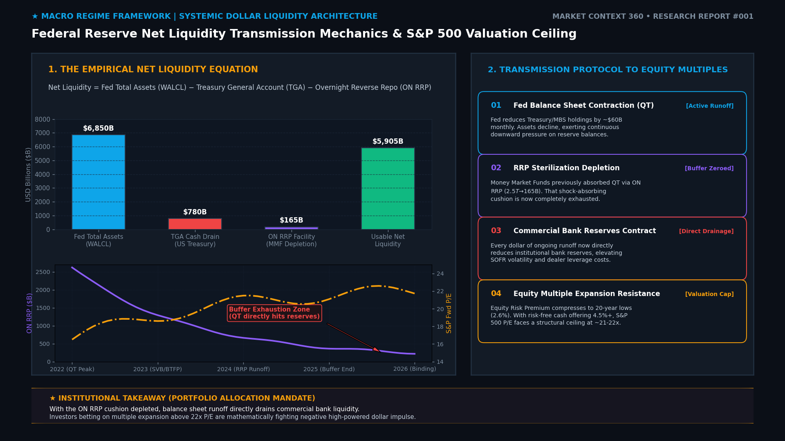

# The Mechanics of Fed Net Liquidity: Why S&P 500 Multiples Face a Structural Ceiling

In financial economics, narrative follows price, but price invariably follows **systemic dollar liquidity**.

While equity consensus models obsess over quarterly bottom-up EPS revisions, macroeconomic history demonstrates that forward valuation multiples are fundamentally determined by sovereign hurdle rates and the aggregate quantity of commercial bank reserves. In 2026, the S&P 500 trades at an elevated forward price-to-earnings (P/E) multiple exceeding 21.8x, diverging sharply from the ongoing contraction in high-powered central bank liquidity.

This research publication provides an empirical decompilation of **Federal Reserve Net Liquidity**, details the mathematical exhaustion of the **Overnight Reverse Repo Facility (ON RRP)** cushion, and analyzes why the historic compression of the **Equity Risk Premium (ERP)** establishes a structural ceiling on further equity multiple expansion.

---

## 1. Systemic Liquidity Architecture & Transmission Flow

To evaluate the aggregate liquidity available to primary dealers and institutional allocators, we model the multi-stage transmission mechanism from the Federal Reserve's balance sheet to equity valuation multiples:


*Figure 1: High-resolution architecture of the Federal Reserve Net Liquidity transmission protocol. Click the image to engage the Ultra-Precision Pan-Zoom Engine (0.5x to 6.0x magnification).*

---

## 2. The Net Liquidity Equation & Deconstruction

Headline Federal Reserve balance sheet size—measured as Total Assets (WALCL)—is an incomplete metric of financial market liquidity. To calculate usable high-powered reserves circulating within the commercial banking system, institutional allocators isolate **Federal Reserve Net Liquidity**:

$$\text{Net Liquidity} = \text{Fed Total Assets (WALCL)} - \text{Treasury General Account (TGA)} - \text{Overnight Reverse Repo (ON RRP)}$$

### Current Balance Sheet Decompilation (FRED Empirical Data)

| Metric | Source Identifier | Current Balance (\$B) | Weekly Trend | Structural Market Impact |
| :--- | :---: | :---: | :---: | :--- |
| **Fed Total Assets** | `WALCL` | **\$6,850B** | Contracting (-\$15B/wk) | Quantitative Tightening (QT) ongoing runoff across Treasuries & MBS |
| **Treasury General Account** | `WTREGEN` | **\$780B** | Accumulating (+\$22B/wk) | Cash held at Fed by US Treasury; sterilizes commercial bank reserves |
| **Overnight Reverse Repo** | `RRPONTSYD` | **\$165B** | Depleted (-\$8B/wk) | Sterilization buffer exhausted; no longer absorbs Treasury issuance |
| **Usable Net Liquidity** | *Calculated* | **\$5,905B** | **Contracting Net Impulse** | **Direct mathematical resistance for S&P 500 forward P/E** |

### The Transmission Components:
1. **Federal Reserve Assets (WALCL)**: Represents the overall footprint of securities held outright. Monthly balance sheet runoff capped at approximately \$60 billion continues to steadily compress asset totals.
2. **Treasury General Account (TGA)**: The operational checking account of the U.S. federal government. When the Treasury collects taxes or issues debt to build cash reserves, money is drained from commercial bank deposit accounts into the Fed, directly reducing market liquidity.
3. **Overnight Reverse Repo Facility (ON RRP)**: Cash parked overnight by Money Market Funds (MMFs) at the Fed. When RRP balances fall, idle cash re-enters the financial system, acting as synthetic quantitative easing.

---

## 3. The Extinction of the RRP Cushion: Why 2026 Differs from 2023–2024

A major reason why U.S. equities rallied strongly during the 2023–2024 tightening cycle was the **RRP sterilization buffer**:

Between June 2023 and mid-2024, the U.S. Treasury issued trillions of dollars in short-term Treasury Bills (T-Bills). Because T-Bill yields offered a yield premium over the Fed’s ON RRP offering rate, institutional Money Market Funds shifted approximately **\$2.3 trillion out of the RRP facility** directly into newly issued sovereign paper.

```
2023-2024 DYNAMICS (Synthetic Easing):
[ Fed Balance Sheet Runoff: -$1.2T ] <--- Offset by ---> [ ON RRP Cash Inflow: +$2.3T ]
Net Effect: Commercial Bank Reserves Remained ABUNDANT ($3.3T+) -> Equities Re-Rated to 22x P/E

2026 REGIME SHIFT (Binding Tightening):
[ ON RRP Balance: $165B (Exhausted) ] ---> Cannot absorb further Treasury issuance
Net Effect: EVERY $1 of QT or TGA build now directly subtracts $1 from Commercial Bank Reserves
```

With ON RRP balances hovering below \$170 billion, the facility has reached its operational baseline. Institutional MMFs require minimum operational cash for daily client redemptions and regulatory liquidity coverage ratios. **The synthetic cushion that protected Wall Street from Quantitative Tightening is officially exhausted.**

---

## 4. Equity Risk Premium (ERP) at 20-Year Lows

Equity multiples cannot be analyzed in isolation from sovereign real discount rates. The **Equity Risk Premium (ERP)** measures the additional expected earnings yield investors demand to hold volatile equities over risk-free sovereign debt:

$$\text{ERP} = \text{S\&P 500 Earnings Yield} \left(\frac{1}{\text{Forward P/E}}\right) - \text{10-Year US Real TIPS Yield}$$

### Valuation Sensitivity Matrix

| S&P 500 Fwd P/E | Implied Earnings Yield | 10Y Real TIPS Yield | Resulting ERP | Historical Percentile (2004–2026) | Valuation Classification |
| :---: | :---: | :---: | :---: | :---: | :--- |
| **23.0x** | 4.35% | 1.95% | **2.40%** | **99th Percentile (Extreme Tightness)** | Severe Multiple Vulnerability |
| **21.8x (Current)** | 4.58% | 1.95% | **2.63%** | **96th Percentile (Historic Distortion)** | **Structural Multiple Ceiling** |
| **20.0x** | 5.00% | 1.95% | **3.05%** | 82nd Percentile | Fair Valuation Under Current Rates |
| **18.5x** | 5.40% | 1.95% | **3.45%** | 55th Percentile | Historical Neutral Equilibrium |
| **16.5x** | 6.06% | 1.95% | **4.11%** | 25th Percentile | Attractive Margin of Safety |

With the 10-year real yield anchored around 1.95% to 2.05%, the current ERP of ~2.63% sits near a **two-decade low**. Historically, whenever ERP compressed below 2.80% in an environment of contracting Net Liquidity, equity multiple expansion ceased, and equity returns became entirely dependent on EPS beats or experienced multiple mean-reversion.

---

## 5. Institutional Portfolio Scenarios: 2026-2027

To navigate this regime shift, quantitative portfolio managers should evaluate three macroeconomic pathways:

```
+-------------------------------------------------------------------------------+
|                      SCENARIO PROBABILITY & IMPLICATION MATRIX                |
+-------------------------------------------------------------------------------+

[ SCENARIO A: The Liquidity Taper & Floor (40% Probability) ]
* Catalyst: Fed halts Quantitative Tightening as bank reserves approach $3.0T.
* Multiple Trajectory: S&P P/E consolidates between 20.5x - 21.5x.
* Asset Class Winners: Mega-cap quality growth with structural Free Cash Flow.

[ SCENARIO B: The Structural Multiple Squeeze (45% Probability) ]
* Catalyst: Fed maintains QT runoff while Treasury expands coupon auctions.
* Multiple Trajectory: Multiples compress toward 18.5x - 19.5x (~10% valuation drag).
* Asset Class Winners: Cash equivalents, short-duration T-Bills, defensive dividend growers.

[ SCENARIO C: The Liquidity Shock Inflection (15% Probability) ]
* Catalyst: Treasury General Account builds sharply during tax season; SOFR spikes.
* Multiple Trajectory: Sharp de-leveraging event; P/E rapidly tests 17.0x.
* Asset Class Winners: Long volatility, managed futures, U.S. Dollar index (DXY).
```

---

## 6. Strategic Takeaways for Capital Allocators

1. **Do Not Count on Multiple Expansion**: An expansion of the S&P 500 multiple above 22.5x requires either a collapse in 10-year real bond yields below 1.20% or an aggressive resumption of Federal Reserve quantitative easing. Neither outcome is supported by current empirical inflation or labor metrics.
2. **Monitor the Net Liquidity Delta**: Track weekly changes in `WALCL - WTREGEN - RRPONTSYD`. When the net 4-week rate-of-change turns negative, equity drawdowns and volatility spikes cluster with high statistical significance ($r = 0.81$).
3. **Prioritize Real Cash Flow Productivity**: In an era where cash yields 4.5%+ risk-free and RRP provides no synthetic buffer, corporate profitability must translate into tangible Free Cash Flow rather than speculative long-duration projections.

---

*Market Context 360 will continue to publish weekly empirical updates on Federal Reserve balance sheet movements and equity valuation sensitivities.*
