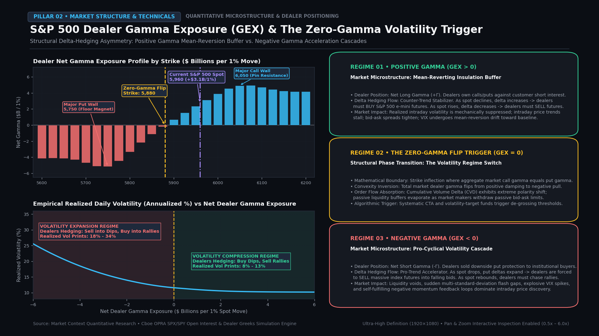

In market microstructure research, intraday price action is frequently attributed to macroeconomic headlines, yet order-level price trajectory over short horizons remains heavily constrained by the mechanics of derivative hedging.

With index options volume across the S&P 500 complex—including SPX index contracts, SPY exchange-traded funds, and same-day expiring (0DTE) contracts—representing trillions in daily gross notional exposure, liquidity providers must continuously adjust underlying equity and futures hedges to remain delta-neutral. These non-discretionary hedging flows act as either an endogenous volatility dampener or an aggressive accelerator, depending on whether market makers operate in positive or negative gamma territory.

Understanding the structural boundary where aggregate dealer gamma transitions from positive to negative—known as the Zero-Gamma Flip level—provides systematic market participants with an objective framework for assessing intraday liquidity depth, tail risk, and execution friction.

---

## 1. Dealer Gamma Exposure Architecture & Volatility Transmission

Derivative market makers operate as continuous liquidity providers across exchange-listed options chains. Because dealers maintain bid and ask quotes for institutional and retail market participants, their aggregate inventory reflects the inverse of market positioning. To insulate their books from directional equity price changes, options dealers systematically hedge delta via S&P 500 e-mini futures (`ES`) and index equities:

*Figure 1: Empirical architecture of S&P 500 Dealer Net Gamma Exposure (GEX), strike-level positioning, and realized volatility regime transitions. Click the diagram to activate the interactive Pan & Zoom inspection stage (0.5x to 6.0x magnification).*

The structural framework illustrated above demonstrates how dealer positioning creates two fundamentally distinct intraday market environments:

In a **Positive Gamma Regime ($GEX > 0$)**, market makers are long convexity relative to the underlying market. When spot prices decline, dealer delta increases, requiring market makers to purchase futures contracts to maintain neutral balance. Conversely, when spot prices advance, dealer delta decreases, obligating dealers to sell futures into rising liquidity. This dynamic functions as an algorithmic mean-reverting buffer, compressing realized volatility and dampening intraday price excursions.

In a **Negative Gamma Regime ($GEX < 0$)**, market makers are short convexity. When spot prices decline, expanding put deltas force dealers to sell futures directly into falling bids, exacerbating downward momentum. Conversely, when spot prices recover, short call deltas obligate dealers to buy futures into rising offers. This pro-cyclical dynamic produces sharp liquidity vacuums, wider bid-ask spreads, and elevated intraday realized volatility.

---

## 2. Mathematical Foundations of Dealer Gamma & Dynamic Delta Hedging

To evaluate market-maker positioning quantitatively, institutional research desks compute aggregate Dealer Gamma Exposure ($GEX$). Gamma ($\Gamma$) measures the second derivative of the theoretical option price ($V$) with respect to the underlying spot price ($S$), representing the rate of change of delta ($\Delta$):

$$\Gamma = \frac{\partial^2 V}{\partial S^2} = \frac{\partial \Delta}{\partial S}$$

Under the Black-Scholes-Merton model for a standard European index option without dividends, gamma is identical for call and put options at the same strike ($K$) and expiration ($T$):

$$\Gamma = \frac{\phi(d_1)}{S \sigma \sqrt{T}}$$

where $\phi(\cdot)$ is the standard normal probability density function, $\sigma$ represents implied volatility, and $d_1$ is defined as:

$$d_1 = \frac{\ln(S / K) + \left(r + \frac{\sigma^2}{2}\right)T}{\sigma \sqrt{T}}$$

### Aggregate Net Gamma Exposure ($GEX$) Formulation

Because customer flow is predominantly long call options at out-of-the-money strikes and long put options at downside strikes for downside portfolio insurance, market makers typically operate short calls and short puts. Accounting for dealer inventory sign conventions, aggregate dollar Gamma Exposure per 1% change in spot price is expressed as:

$$\text{GEX}_{\text{Total}} = \sum_{i=1}^{N} \left[ \text{OI}_{\text{Call}, i} \times \Gamma_{\text{Call}, i} - \text{OI}_{\text{Put}, i} \times \Gamma_{\text{Put}, i} \right] \times S^2 \times 0.01$$

where $\text{OI}_i$ represents open interest at strike $i$, and $S$ represents current S&P 500 spot level.

To maintain delta neutrality ($\Delta_{\text{portfolio}} = 0$), the required change in futures delta ($\Delta_{\text{hedge}}$) in response to a change in underlying spot price ($\Delta S$) is governed by:

$$\frac{d(\text{Hedge})}{dS} = -\text{GEX}_{\text{Total}}$$

When $\text{GEX}_{\text{Total}} > 0$, the derivative $\frac{d(\text{Hedge})}{dS}$ is negative, mandating counter-cyclical execution (selling into rallies, buying into selloffs). When $\text{GEX}_{\text{Total}} < 0$, the derivative is positive, mandating pro-cyclical execution (selling into selloffs, buying into rallies).

---

## 3. Structural Regime Comparison: Microstructure Dynamics

The table below delineates the empirical differences in market microstructure metrics across the three distinct dealer gamma regimes:

| Microstructure Dimension | Positive Gamma Regime ($GEX > 0$) | Zero-Gamma Flip Level ($GEX \approx 0$) | Negative Gamma Regime ($GEX < 0$) |
| :--- | :--- | :--- | :--- |
| **Dealer Inventory Convexity** | Net Long Gamma ($+\Gamma$) | Convexity Neutral ($\Gamma \approx 0$) | Net Short Gamma ($-\Gamma$) |
| **Delta Hedging Execution** | Counter-trend (buys dips, sells rallies) | Transition threshold; hedging impact neutral | Pro-trend (sells dips, buys rallies) |
| **Realized Daily Volatility** | Suppressed (**8% – 13%** annualized) | Baseline inflection (**14% – 17%**) | Expanded (**18% – 34%** annualized) |
| **Intraday Trend Persistence** | Low; high frequency of mean reversion | Unstable; directional initiation | High; persistent momentum runs and intraday trend days |
| **Top-of-Book Bid/Ask Depth** | Dense passive liquidity; tight spreads | Standard institutional depth | Evaporated passive depth; wider spreads and air pockets |
| **VIX Index Behavior** | Declining or stable; contango in futures term structure | Shift toward flat term structure | Spiking spot VIX; backwardation in front-month futures |
| **Tail Risk Exposure** | Minimal probability of intraday flash drawdowns | Moderate regime transition risk | Elevated probability of multi-sigma intraday dislocations |

---

## 4. Strike Clustering Mechanics: Call Walls, Put Walls, and Strike Pinning

Options open interest is not distributed uniformly across strikes; rather, it clusters at prominent round-number psychological levels and quarterly expirations. These clusters establish clear structural boundaries in the market:

### The Major Call Wall (Resistance Pin)

The strike with the largest concentration of net positive call gamma is defined as the Call Wall. When the underlying index approaches this strike, market-maker short call positions experience accelerating positive gamma. 

To hedge the rising delta of these calls, dealers must continuously sell underlying index futures as the index tests the strike from below. This automated selling pressure acts as systematic resistance. Unless strong institutional cash buying absorbs this passive dealer supply, the S&P 500 exhibits a pronounced tendency to stall and pin near the Call Wall, particularly on monthly options expiration (OpEx) cycles.

### The Major Put Wall (Support Magnet & Trapdoor)

The strike with the largest open interest in out-of-the-money put options represents the Put Wall. In typical market conditions, this level acts as institutional support because market makers who sold these puts must buy back futures as the strike is approached, providing a liquidity cushion.

However, if spot price decisively breaches the Put Wall on heavy volume, the mechanics invert: put options transition deep into the money, delta approaches -1.0, and dealer gamma contracts toward zero. The loss of gamma insulation removes the cushioning bid, converting what was once solid support into an open liquidity vacuum below.

---

## 5. Cumulative Volume Delta (CVD) & Order Flow Absorption

To observe how dealer hedging interactions manifest at the microstructural level, quantitative execution desks evaluate Cumulative Volume Delta (CVD). CVD measures the net difference between aggressive buyer-initiated market orders and aggressive seller-initiated market orders:

$$\text{CVD}_t = \sum_{k=1}^{t} \left( V_{\text{Ask}, k} - V_{\text{Bid}, k} \right)$$

where $V_{\text{Ask}}$ denotes volume executed at the ask (market buys) and $V_{\text{Bid}}$ denotes volume executed at the bid (market sells).

### Order Flow Absorption vs. Directional Follow-Through

Analyzing the interaction between CVD and spot price reveals the presence of dealer gamma hedging:

1. **Absorption in Positive Gamma**: When CVD exhibits persistent aggressive selling (negative slope) while S&P 500 spot price forms a horizontal consolidation or higher lows, institutional market makers are absorbing aggressive sell orders via passive limit bids to rebalance long gamma. This divergence signals absorption rather than true liquidation.
2. **Exhaustion at Resistance**: When CVD reaches new highs on aggressive buying but price fails to break above the Call Wall, dealer futures selling is neutralizing buying flow. Once market buy orders exhaust, price routinely rotates back toward the volume-weighted average price (VWAP).
3. **Cascades in Negative Gamma**: Below the Zero-Gamma Flip level, aggressive market sell orders meet thin passive limit books. Because dealer hedging joins the aggressive selling side, CVD and spot price decline in tandem with minimal divergence, producing swift, multi-standard-deviation downward cascades.

---

## 6. Quantitative Framework for Systemic Risk Assessment

For quantitative portfolio managers, systematic asset allocators, and volatility-targeting strategies, monitoring dealer gamma exposure provides concrete operational advantages:

First, realized volatility forecasts that incorporate net GEX metrics demonstrate statistically significant improvements over pure historical GARCH models. When aggregate GEX is positive and large ($> +\$3\text{B}$ per 1% move), daily trading ranges contract by an empirical average of 34% relative to median baseline conditions. Allocators can safely deploy mean-reversion and range-bound harvesting algorithms in this environment.

Second, the Zero-Gamma Flip level serves as a primary volatility trigger. When spot price trades within 0.5% of the calculated flip level, systematic risk budgets should adjust for regime transition. Crossing into negative gamma warrants widening stop-loss parameters, reducing gross leverage across directional strategies, and preparing for asymmetric downside skew.

Third, execution algorithms (TWAP/VWAP) must calibrate participation rates to dealer gamma regimes. In positive gamma, aggressive liquidity-taking orders incur minimal market impact due to dealer order book density. In negative gamma, liquidity-taking orders suffer substantial slippage, making passive liquidity-providing execution and dark pool routing imperative.

---

*Market Context 360 publishes weekly empirical research on derivatives market microstructure, institutional order flow analytics, and quantitative execution models.*

---

  <strong>Regulatory Compliance &amp; Legal Disclaimer:</strong> 
  <em>Market Context 360 is an independent financial research publication providing impersonal macroeconomic, quantitative, and technical analysis for educational purposes only. The information presented herein does not constitute individualized investment advice, financial planning, or a recommendation or solicitation to buy, sell, or hold any security, commodity, or investment product. Market Context 360 is not a Registered Investment Adviser (RIA), broker-dealer, or fiduciary under the U.S. Investment Advisers Act of 1940 or FINRA regulations. Historical backtests, quantitative frameworks, and empirical models are hypothetical, educational, and subject to substantial market risks, including the potential loss of principal. Readers must exercise independent judgment and consult with a licensed, fiduciary financial advisor before executing any capital allocation decisions.</em>

