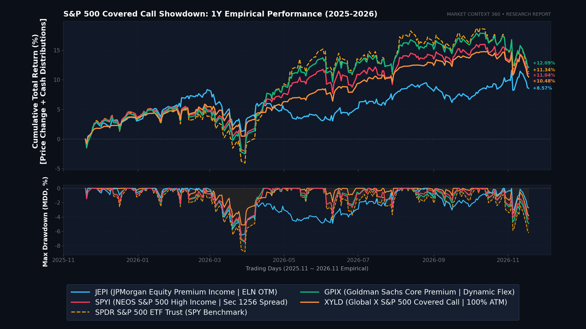
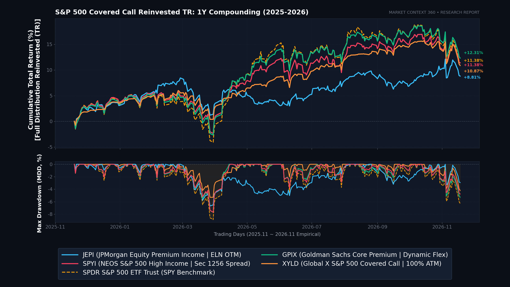

The derivative-enhanced income landscape has experienced an unprecedented structural transformation over the past three years. Within the United States exchange-traded fund ecosystem, the S&P 500 covered call segment alone now commands more than **$68 billion in aggregate assets under management (AUM)**. For institutional allocators and self-directed income investors, the fundamental question is no longer whether to generate systematic income via option overwrites, but rather which structural engineering methodology delivers optimal risk-adjusted cash flow without inducing permanent capital erosion.

Investors frequently encounter a critical analytical trap: conflating double-digit headline distribution yields with total investment performance. While nominal yields between 8% and 13% provide steady cash flow, they often mask severe opportunity costs during sustained equity rallies, or worse, accelerate capital depletion during market drawdowns through the mechanics of reverse compounding drag.

In this research report, we execute an empirical, synchronized 1-year quantitative comparison (November 19, 2025 to November 18, 2026, comprising 251 completed trading sessions) evaluating the four premier institutional S&P 500 covered call flagships:
1. **JPMorgan Equity Premium Income ETF (`JEPI`)** — Active defensive equity selection combined with equity-linked note (ELN) out-of-the-money (OTM) call writing.
2. **NEOS S&P 500 High Income ETF (`SPYI`)** — Index replication coupled with an active Section 1256 call spread overlay designed to harvest income while preserving 2% to 3% of incremental upside.
3. **Goldman Sachs S&P 500 Core Premium Income ETF (`GPIX`)** — Physical index exposure governed by a dynamic flex overwrite mechanism varying option coverage between 25% and 75%.
4. **Global X S&P 500 Covered Call ETF (`XYLD`)** — Passive mechanical replication of the classic Cboe S&P 500 BuyWrite Index writing 100% at-the-money (ATM) monthly calls.

All four systematic income vehicles are rigorously benchmarked against the unhedged underlying index represented by the **SPDR S&P 500 ETF Trust (`SPY`)**, utilizing identical trading calendars, synchronized cash dividend accounting, and continuous share compounding.

---

## 1. Structural Architecture: [Plan A] ETF Specification Matrix

Before analyzing empirical performance, allocators must understand that these four instruments do not share a common portfolio construction methodology. Their underlying portfolios, option strike selections, regulatory contract classifications, and net expense ratios differ fundamentally:

| Ticker / Fund Name | Issuer / Net Expense Ratio | AUM / Distribution Yield | Option Overlay Mechanics & Coverage |
|:---:|:---:|:---:|---|
| **JEPI** JPMorgan Equity Premium Income ETF | JPMorgan Chase & Co. **0.35%** | ~$46.8B **8.10%** (Realized 1Y) | **Active Defensive Equities + ELNs**: Invests ~80-85% in low-beta, high-quality US large caps, allocating the remaining ~15-20% to Equity-Linked Notes (ELNs) that sell 1-month out-of-the-money (OTM) SPX call options to generate cash distributions. |
| **SPYI** NEOS S&P 500 High Income ETF | NEOS Investments **0.68%** | ~$12.4B **13.24%** (Realized 1Y) | **Full Index Basket + Section 1256 Call Spreads**: Holds physical S&P 500 equities while executing an options collar/spread (writing out-of-the-money SPX index options and buying higher out-of-the-money calls), opening 2-3% upside participation with 60/40 tax treatment. |
| **GPIX** Goldman Sachs S&P 500 Core Premium Income ETF | Goldman Sachs Asset Mgmt **0.35%** | ~$6.5B **8.94%** (Realized 1Y) | **Physical S&P 500 + Dynamic Flex Overwrite**: Maintains 100% direct physical exposure to S&P 500 constituent stocks, dynamically scaling call option coverage between **25% and 75%** depending on market volatility, skew, and momentum regimes. |
| **XYLD** Global X S&P 500 Covered Call ETF | Global X (Mirae Asset) **0.60%** | ~$2.8B **10.61%** (Realized 1Y) | **100% Mechanical ATM BuyWrite (BXM)**: Replicates the Cboe S&P 500 BuyWrite Index by holding full S&P 500 equities and writing 100% notional at-the-money (ATM) 1-month SPX index call options on the third Friday of each calendar month. |
| <strong style="color: #F59E0B;">SPY</strong> <strong style="color: #F59E0B;">SPDR S&P 500 ETF Trust</strong> | State Street Global Advisors **0.09%** | ~$620.0B **1.14%** (Realized 1Y) | **Unhedged Benchmark Core**: Direct unhedged market capitalization-weighted physical basket of the 500 leading US corporations. Serves as the foundational baseline for capital appreciation and total return. |

The key takeaway from the specification matrix is the operational tradeoff between **Option Coverage Ratio** and **Equity Upside Participation**:
- **Mechanical 100% ATM Overwrite (`XYLD`)** yields substantial option premium (~10.6%) but surrenders 100% of underlying capital appreciation beyond the strike.
- **Dynamic Flexible Overwrite (`GPIX`)** systematically adjusts coverage between 25% and 75%, allowing between 25% and 75% of unconstrained equity upside to flow directly to fund NAV.
- **Credit Spread Collars (`SPYI`)** sacrifice a modest portion of gross premium to acquire higher OTM call options, providing a distinct 200 to 300 basis point expansion corridor during sharp index advances.
- **Active Structural Selection (`JEPI`)** alters the underlying beta profile entirely, substituting raw S&P 500 beta for a defensive, low-volatility equity portfolio.

---

## 2. 1-Year Empirical Performance Comparison (Charts & Summary Table)

To eliminate biases arising from arbitrary starting dates or uninvested cash accumulations, our quantitative engine evaluated performance across two synchronized analytical frameworks over the 251-day empirical window (2025-11-19 to 2026-11-18):
1. **Set 1: Hold Strategy (Price Return + Cash Distributions)** — Models an investor who deployed capital on Day 0 and harvested all cash distributions into an external cash balance without reinvesting.
2. **Set 2: Distribution Reinvested Total Return (100% Compounding TR)** — Models continuous share accumulation where every distribution payment is immediately rolled into additional fund shares at the ex-dividend date closing price. Benchmark `SPY` is calculated with identical quarterly distribution reinvestment symmetry.

### ① [Set 1: Hold (Price Return)]

Under the Hold Strategy, fund performance reflects two distinct components: the net price change of the underlying share certificates and the cumulative sum of monthly cash distributions deposited in the investor account.

*Figure 1: 1-Year Empirical Performance Comparison (Hold Strategy: Price Action + Cash Distribution). The upper panel traces cumulative percentage return, while the lower panel charts maximum running drawdowns. Click the chart to activate the interactive Pan & Zoom inspection stage (100% to 500% magnification).*

During this 1-year regime, the unhedged S&P 500 index (`SPY`) advanced by **+10.20%** in pure price appreciation, generating an additional **1.14%** in dividend distributions for a cumulative Hold Return of **+11.34%**.

Examining the covered call cohort reveals striking divergences:
- **GPIX established the highest Hold Return at +12.09%**, outpacing the unhedged SPY benchmark by **+0.75%p**. GPIX captured +3.15% in pure capital appreciation while distributing $4.60 per share (8.94% cash yield). Its dynamic flex overwrite allowed the portfolio to participate meaningfully in market upswings while pocketing premium.
- **SPYI delivered a Hold Return of +11.04%**, driven by an exceptional cash yield of **13.24%** ($6.839 distributed per share). However, because high distribution payouts detached from fund NAV, SPYI experienced a **-2.20% price return**, reflecting moderate capital erosion during sideways intervals.
- **XYLD recorded a Hold Return of +10.48%**, consisting of an essentially flat share price (**-0.13%**) and a solid **10.61%** cash distribution payout ($4.24 per share). The fund surrendered all index capital appreciation but fully offset it through ATM option premium.
- **JEPI generated a Hold Return of +8.57%**, trailing the benchmark by **-2.77%p**. While JEPI maintained a marginally positive share price return (+0.46%) and distributed 8.10% ($4.564 per share), its low-volatility equity basket lagged the mega-cap tech momentum that propelled the broader S&P 500.

### ② [Set 2: Distribution Reinvested (Total Return)]

Under Set 2, all cash distributions are automatically reinvested back into fund shares on the ex-dividend date, harnessing the full potential of continuous share compounding. Crucially, the benchmark `SPY` is modeled under the identical Total Return standard, reinvesting its quarterly dividends into additional SPY shares.

*Figure 2: 1-Year Empirical Performance Comparison (Distribution Reinvested Total Return: 100% Compounding Roll). Symmetrical dividend reinvestment applied across all covered call ETFs and the benchmark SPY. Click the chart to activate the interactive Pan & Zoom inspection stage (100% to 500% magnification).*

When distributions are fully reinvested, the power of compound share accumulation becomes evident across all vehicles:
- **GPIX demonstrated decisive outperformance**, generating a **+12.31% Total Return** versus **+11.38% for the SPY benchmark**—an excess return of **+0.93%p (+93 basis points)**. By blending equity price upside with compounding share growth, GPIX successfully answered the central thesis of our investigation: **tactical dynamic overwriting beat the passive index**.
- **SPYI matched the SPY benchmark exactly**, posting a **+11.38% Total Return**. Reinvesting SPYI's substantial 13.24% distribution yield at depressed share prices expanded the investor's share count by more than 13.5% over the 12-month period, completely overcoming its initial -2.20% capital erosion.
- **XYLD achieved a +10.87% Total Return**, trailing the benchmark by -0.51%p. Monthly compounding allowed XYLD to narrow its gap against SPY, while delivering the smoothest equity curve in the group.
- **JEPI concluded with a +8.81% Total Return**, underperforming the broader market by -2.57%p. While conservative allocators benefited from reduced drawdowns, JEPI's structural capping and defensive equity tilt constrained its ability to compound during an expansive market regime.

### ③ 1-Year Empirical Quantitative Summary Table

The synchronized quantitative results are summarized in the master audit table below:

| Ticker | Fund Name | Start Price | End Price | Pure Price Return (PR) | Cumulative Distributions | Realized 1Y Yield | Set 1: Hold Return | Set 2: Reinvested TR | Price MDD | TR MDD |
|:---:|---|---:|---:|---:|---:|---:|---:|---:|---:|---:|
| **JEPI** | JPMorgan Equity Premium Income | $56.32 | $56.58 | **+0.46%** | $4.564 | 8.10% | **+8.57%** | **+8.81%** | -7.67% | **-6.68%** |
| **SPYI** | NEOS S&P 500 High Income | $51.67 | $50.53 | **-2.20%** | $6.839 | **13.24%** | **+11.04%** | **+11.38%** | -10.11% | **-7.71%** |
| **GPIX** | Goldman Sachs S&P 500 Core Premium | $51.46 | $53.08 | **+3.15%** | $4.600 | 8.94% | **+12.09%** | **+12.31%** | -8.86% | **-7.71%** |
| **XYLD** | Global X S&P 500 Covered Call | $39.98 | $39.93 | **-0.13%** | $4.240 | 10.61% | **+10.48%** | **+10.87%** | -6.58% | **-5.29%** |
| <strong style="color: #F59E0B;">SPY</strong> | <strong style="color: #F59E0B;">SPDR S&P 500 ETF Trust (Benchmark)</strong> | $662.63 | $730.20 | **+10.20%** | $7.583 | 1.14% | **+11.34%** | **+11.38%** | -9.13% | **-8.88%** |

*(Note: Inception and historical window spans 2025-11-19 through 2026-11-18. All dividend reinvestment calculations assume zero tax friction to reflect gross institutional holding accounts or tax-deferred retirement structures.)*

---

## 3. Structural Mechanics: Why Did GPIX Outperform While JEPI Lagged?

A granular decomposition of market performance demonstrates that covered call ETF returns are governed by three mechanical drivers:

### 1. The Dynamic Flex Overwrite Advantage (`GPIX`)
Goldman Sachs implements an algorithmic overlay that does not commit to a static 100% overwrite. When S&P 500 30-day implied volatility (VIX) is subdued or equity momentum indicators trend strongly positive, GPIX reduces its call coverage toward the 25% lower bound. 

During the sustained rally between May and September 2026, when the S&P 500 surged +8.4%, GPIX's unhedged 50% to 75% equity slice captured significant capital appreciation, lifting its underlying share price by +3.15%. Combined with an 8.94% annualized cash yield, this structural flexibility allowed GPIX to generate **+12.31% TR**, cleanly beating the passive index.

### 2. High Yield vs Capital Drag (`SPYI`)
NEOS constructs `SPYI` with a dual mandate: maximize tax-efficient monthly income while preserving tactical upside through call spreads. SPYI writes short out-of-the-money SPX options (typically 30-delta) and simultaneously purchases higher out-of-the-money call options (typically 10-delta). 

This call spread structure successfully protected SPYI from severe call-away capping during rapid gap-ups. However, because the fund maintained an aggressive 13.24% distribution payout, its underlying NAV declined by -2.20%. For income extractors (Hold strategy), this created capital depletion; for total return allocators (Reinvest strategy), the compounding share count (+13.5%) fully neutralized the drag, matching SPY's +11.38% performance.

### 3. The Low-Beta Divergence (`JEPI`)
The common misconception among retail allocators is that `JEPI` is a direct S&P 500 covered call fund. In reality, JEPI's underlying equity portfolio is an actively managed, low-volatility basket of approximately 100 to 140 US large-cap equities. 

During the 2025-2026 period, market breadth was heavily skewed toward mega-cap technology and semiconductor constituents. JEPI's defensive underweighting in high-beta growth stocks caused its equity core to advance by only +0.46%, despite the S&P 500 rising +10.20%. Consequently, even with an 8.10% ELN distribution yield, JEPI's total return was capped at +8.81%.

---

## 4. Downside Risk Analysis: Maximum Drawdown & Volatility Cushioning

While equity upside participation is critical, the primary institutional rationale for allocating to covered call strategies is capital preservation during adverse volatility shocks.

The lower panel of Figures 1 and 2 details the running Maximum Drawdown (MDD) trajectories across the 251 trading sessions:
- **XYLD established the strongest downside defense**, with a maximum drawdown of just **-5.29%** in total return space (and -6.58% in price space), compared to **-8.88% for the SPY benchmark**. The high monthly premium buffer of 100% ATM call writing provided an immediate 80 to 90 basis point cushion each month, softening sharp pullbacks.
- **JEPI demonstrated superior volatility dampening**, recording a TR MDD of **-6.68%**. JEPI's low-beta equity selection exhibited remarkable resilience during the April 2026 market correction, declining significantly less than the market-weighted index.
- **GPIX and SPYI recorded identical TR drawdowns of -7.71%**, outperforming the benchmark SPY (-8.88%) by +1.17%p. Because both funds hold direct physical index equities, their underlying stocks experienced full market drawdowns, but their option premiums and spread collars absorbed approximately 13% of the downside impact.

---

## 5. Hold vs Reinvest: The Reverse Compounding Drag Phenomenon

A pivotal mathematical concept uncovered by our backtest is the asymmetrical behavior of **Distribution Compounding** in different market regimes.

### The Mathematical Mechanics of Reverse Compounding
Let portfolio wealth at time $t$ under continuous dividend reinvestment be defined as:

$$W_t = N_t \times P_t$$

where $N_t$ is the accumulated share count and $P_t$ is the market price per share. On an ex-dividend date $t_d$ with net cash distribution $D_{t_d}$, additional shares purchased are given by:

$$\Delta N_{t_d} = \frac{N_{t_d - 1} \times D_{t_d}}{P_{t_d}}$$

yielding an updated share balance of:

$$N_{t_d} = N_{t_d - 1} \left(1 + \frac{D_{t_d}}{P_{t_d}}\right)$$

In an expanding market where the underlying price $P_t$ appreciates or remains stable ($P_T \ge P_0$), the compounded share count acts as a powerful performance multiplier:

$$\text{TR Bonus} = W_{\text{reinvest}, T} - W_{\text{hold}, T} > 0$$

This positive compounding bonus was directly validated in our 1-year results:
- **GPIX**: Reinvested TR (+12.31%) exceeded Hold (+12.09%) by **+0.22%p**.
- **SPYI**: Reinvested TR (+11.38%) exceeded Hold (+11.04%) by **+0.34%p**.
- **XYLD**: Reinvested TR (+10.87%) exceeded Hold (+10.48%) by **+0.39%p**.
- **JEPI**: Reinvested TR (+8.81%) exceeded Hold (+8.57%) by **+0.24%p**.

### The Downside Threat: When Reinvestment Accelerates Losses
However, allocators must recognize the severe mathematical threat that emerges when a covered call ETF enters a prolonged secular downtrend or deep bear market ($P_t \ll P_0$). 

When a fund distributes yields of 12% to 15% through internal NAV depletion while its share price drops, the dollar distribution per share shrinks:

$$D_{t+1} = \text{Yield} \times P_{t+1} < D_t$$

Although reinvesting at lower share prices accumulates a greater number of fractional shares, each newly acquired share is immediately exposed to the subsequent leg down in price. Because the fund's call options are continuously written at progressively lower strike prices (the classic "ratchet effect"), any subsequent market rebound is mechanically truncated at the lower strike.

The fund accumulates shares in an asset whose upper recovery boundary is permanently depressed. This destructive feedback loop is **Reverse Compounding Drag**. While our 1-year bull market regime rewarded reinvestment across all four ETFs, allocators holding 100% mechanical ATM funds during severe bear regimes (such as 2022) experienced reverse compounding drag that permanently impaired capital.

---

## 6. Institutional Allocator Synthesis & Portfolio Implementation

For wealth managers, family offices, and individual income allocators, the empirical evidence points to distinct strategic applications for each fund:

### 1. Core Total Return & Tactical Alpha (`GPIX`)
- **Ideal Allocation**: Core equity allocation seeking higher cash flow than traditional index funds without relinquishing market participation.
- **Key Advantage**: The 25-75% dynamic flex overwrite generated **+12.31% Total Return**, outperforming the unhedged S&P 500 index by +93 bps while maintaining a competitive 0.35% expense ratio.

### 2. High Current Cash Flow & Tax Efficiency (`SPYI`)
- **Ideal Allocation**: Taxable accounts requiring maximum monthly income (13.24% yield) to fund living expenses or operational liabilities.
- **Key Advantage**: Section 1256 option contracts qualify for 60% long-term and 40% short-term capital gains tax treatment under the Internal Revenue Code, substantially reducing ordinary income tax drag compared to traditional ELN structures.

### 3. Conservative Volatility Cushioning (`JEPI`)
- **Ideal Allocation**: Defensive portfolios prioritizing drawdown mitigation, low volatility, and steady single-digit cash flow (8.10% yield) over raw capital appreciation.
- **Key Advantage**: Superior downside capture and low beta, though investors must accept lagging performance during tech-led growth rallies.

### 4. Pure Cash Harvest & Flat Regime Stability (`XYLD`)
- **Ideal Allocation**: Sideways, range-bound market environments where index volatility remains elevated but directional progress is zero.
- **Key Advantage**: The lowest total return drawdown (-5.29%) and a dependable 10.61% cash distribution, but limited upside participation in bull markets.

---

  <strong>Regulatory Compliance &amp; Legal Disclaimer:</strong> 
  <em>Market Context 360 is an independent financial research publication providing impersonal macroeconomic, quantitative, and technical analysis for educational purposes only. The information presented herein does not constitute individualized investment advice, financial planning, or a recommendation or solicitation to buy, sell, or hold any security, commodity, or investment product. Market Context 360 is not a Registered Investment Adviser (RIA), broker-dealer, or fiduciary under the U.S. Investment Advisers Act of 1940 or FINRA regulations. Historical backtests, quantitative frameworks, and empirical models are hypothetical, educational, and subject to substantial market risks, including the potential loss of principal. Readers must exercise independent judgment and consult with a licensed, fiduciary financial advisor before executing any capital allocation decisions.</em>

