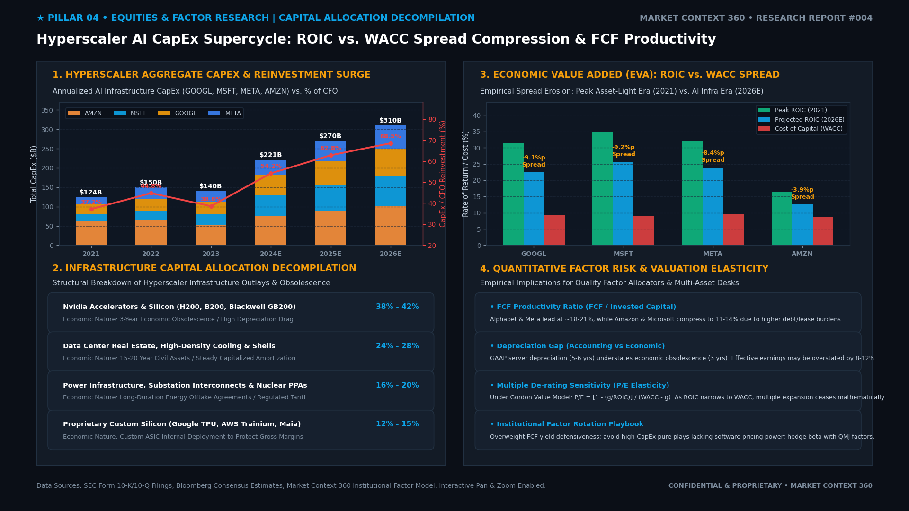

The secular valuation premium enjoyed by megacap technology over the past decade was underpinned by a distinctive financial model: asset-light software monopolies generating gross margins exceeding 70%, minimal capital intensity, and operating cash flow (CFO) conversion rates into unencumbered free cash flow (FCF) near 80%.

Between FY2015 and FY2021, Alphabet, Microsoft, Meta, and Amazon expanded aggregated revenues by 240% while aggregate capital expenditures absorbed less than 38% of operating cash flow. This structural dynamic permitted massive, non-dilutive share repurchases, continuous margin expansion, and a persistent return on invested capital (ROIC) spread over the weighted average cost of capital (WACC) exceeding 2,000 basis points.

The rapid scaling of generative artificial intelligence and frontier foundation models has fundamentally inverted this capital structure. To maintain technical parity and secure enterprise workloads, hyperscalers have entered an aggressive, capital-intensive infrastructure cycle characterized by multi-gigawatt data center developments, direct power purchase agreements, and large-scale procurement of graphics processing units (GPUs) and custom application-specific integrated circuits (ASICs). 

With consensus hyperscaler capital expenditures reaching $270.0 billion in FY2025 and projected to surpass $310.0 billion in FY2026, institutional allocators face a fundamental asset pricing transition: the shift of megacap technology from high-margin, asset-light platforms into capital-intensive, industrial-type infrastructure providers.

This research paper provides an empirical decompilation of hyperscaler balance sheets, quantifies the erosion of economic value added (EVA) spreads, evaluates accounting distortions arising from depreciable useful life mismatches, and examines the implications of capital intensity for cross-sectional factor risk premia.

---

## 1. Capital Allocation Architecture: The Megacap CapEx Supercycle

The ongoing expansion in capital intensity represents an unprecedented reallocation of corporate cash flows. Primary hyperscalers have escalated infrastructure outlays from discretionary optimization into non-negotiable defensive spending to prevent platform disintermediation.

*Figure 1: Empirical architecture of Hyperscaler AI Infrastructure Capital Expenditures, aggregate CFO reinvestment intensity, ROIC vs. WACC spread erosion, and structural factor risk premia across Alphabet, Microsoft, Meta, and Amazon. Click the diagram to activate the interactive Pan & Zoom inspection stage (0.5x to 6.0x magnification).*

To assess the magnitude of this transition, we examine reported and consensus financial disclosures across the four primary hyperscalers:

### Hyperscaler Capital Expenditure & Reinvestment Intensity (FY2021 – FY2026E)

| Corporation | Ticker | FY2021 CapEx (\$B) | FY2023 CapEx (\$B) | FY2024E CapEx (\$B) | FY2025E CapEx (\$B) | FY2026E CapEx (\$B) | FY2026E CapEx / CFO (%) |
| :--- | :---: | :---: | :---: | :---: | :---: | :---: | :---: |
| **Amazon.com Inc.** | `AMZN` | \$61.1B | \$52.7B | \$75.0B | \$88.0B | \$102.0B | 67.5% |
| **Microsoft Corp.** | `MSFT` | \$20.6B | \$28.1B | \$55.7B | \$68.0B | \$78.0B | 61.2% |
| **Alphabet Inc.** | `GOOGL` | \$24.6B | \$32.3B | \$51.5B | \$62.0B | \$70.0B | 54.8% |
| **Meta Platforms** | `META` | \$18.6B | \$27.3B | \$39.0B | \$52.0B | \$60.0B | 62.5% |
| **Aggregate Total** | **Consortium** | **\$124.9B** | **\$140.4B** | **\$221.2B** | **\$270.0B** | **\$310.0B** | **61.8%** |

> Source: SEC Form 10-K filings, consensus research estimates, and company quarterly disclosures.

### Decompilation of Infrastructure Expenditure Outlays

Hyperscaler capital expenditures are distributed across four structural components:

1. **Semiconductor Compute Silicon (38% to 42%)**: Direct procurement of high-performance GPU systems (e.g., Nvidia Hopper H100/H200 and Blackwell GB200 architectures), high-bandwidth memory (HBM3e/HBM4), and high-speed InfiniBand/Ethernet switching fabrics. This hardware segment exhibits the highest obsolescence velocity in computing history.
2. **Data Center Facilities & Liquid Cooling (24% to 28%)**: Construction of high-density computational facilities engineered to support rack thermal envelopes exceeding 100 kW per rack, necessitating transition from legacy chilled-air cooling to direct-to-chip liquid cooling manifolds and external cooling distribution units (CDUs).
3. **Power Interconnection & Dedicated Energy Offtake (16% to 20%)**: Capitalized investments in substation interconnections, high-voltage transmission lines, and long-term utility agreements, including direct power purchase agreements (PPAs) with nuclear, geothermal, and natural gas thermal operators.
4. **Proprietary ASIC Development (12% to 15%)**: Sustained capital commitment to internal silicon engineering programs—such as Google's Tensor Processing Units (TPU v5p/v6e), Amazon's Trainium2 and Inferentia2, and Microsoft's Maia 100—designed to establish captive architectural independence from external merchant silicon.

The mathematical consequence of this infrastructure deployment is an unprecedented expansion of the Reinvestment Rate ($\text{RR}$), defined as:

$$\text{Reinvestment Rate} = \frac{\text{Capital Expenditures}}{\text{Cash Flow from Operations}}$$

Prior to FY2022, hyperscalers operated with a median Reinvestment Rate of 37.2%, leaving approximately 62.8% of operating cash flow available for discretionary capital returns and balance sheet liquidity reserves. By FY2026E, consensus projections indicate the aggregate Reinvestment Rate will rise to 61.8%, with Amazon and Meta reinvesting over 62% to 68% of their operational cash generation into capitalized assets.

---

## 2. The ROIC vs. WACC Spread Framework: Economic Value Added Compression

In corporate valuation theory, sustainable equity value creation is governed not by nominal top-line revenue growth, but by the magnitude of the spread between Return on Invested Capital ($\text{ROIC}$) and the Weighted Average Cost of Capital ($\text{WACC}$). The fundamental decompilation of hyperscaler capital allocation connects three foundational identities:

$$\text{ROIC} = \frac{\text{NOPAT}}{\text{Invested Capital}}, \quad \text{EVA} = \text{Invested Capital} \times (\text{ROIC} - \text{WACC}), \quad \text{FCF} = \text{CFO} - \text{CapEx}$$

$$\text{ROIC} = \frac{\text{NOPAT}}{\text{Invested Capital}}$$

$$\text{EVA Spread} = \text{ROIC} - \text{WACC}$$

$$\text{Economic Value Added (EVA)} = \text{Invested Capital} \times (\text{ROIC} - \text{WACC})$$

When $\text{ROIC} > \text{WACC}$, capital reinvestment compounds economic net worth and justifies valuation multiples above asset replacement value. However, if $\text{ROIC}$ contracts toward $\text{WACC}$, additional capital deployment ceases to create economic value and functions as value-neutral or value-destructive balance sheet expansion, regardless of accounting revenue growth rates.

### Theoretical Formulation of Invested Capital & ROIC

Return on Invested Capital is computed using Net Operating Profit After Tax ($\text{NOPAT}$) divided by average Invested Capital ($\text{IC}$):

$$\text{ROIC} = \frac{\text{NOPAT}}{\text{Invested Capital}} = \frac{\text{EBIT} \times (1 - t)}{\text{Total Debt} + \text{Total Equity} - \text{Excess Cash}}$$

where $t$ represents the effective corporate marginal cash tax rate, and Invested Capital isolates operating assets deployed in core business activities, net of non-operating cash reserves and non-interest-bearing current liabilities (NIBCL).

### Cost of Capital (WACC) Dynamics in an Elevated Sovereign Rate Regime

The Weighted Average Cost of Capital is formulated as:

$$WACC = \left( \frac{E}{V} \times K_e \right) + \left( \frac{D}{V} \times K_d \times (1 - t) \right)$$

where $E/V$ is the equity weight of total enterprise value, $D/V$ is the debt weight, $K_d$ is the pre-tax marginal cost of debt, and $K_e$ is the cost of equity derived from the Capital Asset Pricing Model (CAPM):

$$K_e = R_f + \beta_i \times \text{Equity Risk Premium (ERP)}$$

With the U.S. 10-Year Treasury Yield ($R_f$) anchored near 4.40%, an institutional Equity Risk Premium ($ERP$) estimated at 4.60%, and megacap equity betas ($\beta$) situated between 1.05 and 1.25, the nominal cost of equity across technology leaders sits between 9.2% and 10.1%. When combined with post-tax marginal debt costs ($K_d \times (1 - t) \approx 3.8\%$), institutional baseline WACC hurdles for hyperscalers have reset significantly higher:

- **Alphabet WACC**: 9.2%
- **Microsoft WACC**: 9.0%
- **Meta Platforms WACC**: 9.6%
- **Amazon WACC**: 8.8%

### Empirical ROIC-WACC Spread Decompilation

To evaluate economic value creation during the AI infrastructure transition, we contrast peak asset-light software economics (FY2021) with projected infrastructure economics (FY2026E):

| Metric | Alphabet (`GOOGL`) | Microsoft (`MSFT`) | Meta (`META`) | Amazon (`AMZN`) |
| :--- | :---: | :---: | :---: | :---: |
| **FY2021 ROIC** | 31.5% | 34.8% | 32.2% | 16.4% |
| **FY2021 WACC** | 6.8% | 6.5% | 7.1% | 6.2% |
| **FY2021 EVA Spread** | **+24.7%** | **+28.3%** | **+25.1%** | **+10.2%** |
| **FY2026E ROIC** | 22.4% | 25.6% | 23.8% | 12.5% |
| **FY2026E WACC** | 9.2% | 9.0% | 9.6% | 8.8% |
| **FY2026E EVA Spread** | **+13.2%** | **+16.6%** | **+14.2%** | **+3.7%** |
| **Spread Contraction ($\Delta$)** | **-1,150 bps** | **-1,170 bps** | **-1,090 bps** | **-650 bps** |
| **Invested Capital FY21 (\$B)** | \$185B | \$170B | \$110B | \$240B |
| **Invested Capital FY26E (\$B)** | \$385B | \$390B | \$265B | \$480B |

> Source: Company Annual Form 10-K Filings, Capital IQ consensus databases, and Market Context quantitative balance sheet decompilation models.

The empirical findings demonstrate clear structural compression:

While all four corporations maintain positive absolute economic value added, their net EVA spreads will have compressed by 650 to 1,170 basis points between FY2021 and FY2026E. 

This compression is driven by two simultaneous mechanisms:
First, the denominator (Invested Capital) is expanding at a compound annual rate of 15% to 22% due to cumulative multi-hundred-billion-dollar CapEx capitalization. 
Second, the cost of capital benchmark has elevated by 230 to 260 basis points due to higher benchmark interest rates. Consequently, incremental capital invested in AI infrastructure delivers substantially lower marginal economic profit than historical software investments.

---

## 3. Depreciable Useful Life Distortions & FCF Productivity

A critical structural challenge in analyzing hyperscaler financial statements lies in the accounting treatment of infrastructure depreciation versus actual economic obsolescence.

Under U.S. GAAP, fixed capital investments do not hit the income statement immediately; instead, they are capitalized on the balance sheet and expensed through Depreciation and Amortization (D&A) across their estimated useful life:

$$\text{Straight-Line Annual Depreciation} = \frac{\text{Historical Asset Cost} - \text{Salvage Value}}{\text{Estimated Useful Life (Years)}}$$

### The Useful Life Accounting Arbitrage

Between 2020 and 2023, Alphabet, Microsoft, Meta, and Amazon systematically adjusted the estimated useful life of their cloud server hardware upward from three to four years, and subsequently from four to six years. 

While extending depreciable schedules reduces annual GAAP depreciation charges and inflates reported operating profit ($\text{EBIT}$), it creates an acute divergence from the technological reality of accelerated AI silicon cycles:

1. **Silicon Obsolescence Velocity**: Cutting-edge AI accelerators follow rapid architecture release cadences (12- to 18-month cycles, as demonstrated by Nvidia's transition from A100 to H100, H200, and Blackwell B200). A GPU cluster deployed in 2023 experiences substantial economic obsolescence within 36 months, as newer hardware provides 3x to 5x higher compute density per megawatt.
2. **Depreciation Inadequacy**: When hardware becomes economically obsolete or commercially unviable for frontier training after three years, carrying residual book value across a six-year schedule leaves substantial unamortized capital on the balance sheet.
3. **The Depreciation Replacement Cliff**: When obsolete accelerators must be decommissioned and replaced, corporations face sudden non-cash impairment write-downs or accelerated depreciation recognition, depressing future reported earnings.

### The FCF Productivity Ratio

To neutralize accounting depreciation policies, institutional research desks evaluate unencumbered Free Cash Flow ($\text{FCF}$) and the **FCF Productivity Ratio** ($\text{FCFP}$), which measures the raw cash flow generated per unit of invested capital:

$$\text{FCF} = \text{CFO} - \text{CapEx} = \text{Cash Flow from Operations} - \text{Capital Expenditures}$$

$$\text{FCF Productivity} = \frac{\text{Free Cash Flow}}{\text{Average Invested Capital}} = \frac{\text{Cash Flow from Operations} - \text{Capital Expenditures}}{\text{Total Debt} + \text{Total Equity} - \text{Excess Cash}}$$

### Hyperscaler Free Cash Flow Productivity Profile

| Metric | Alphabet (`GOOGL`) | Microsoft (`MSFT`) | Meta (`META`) | Amazon (`AMZN`) |
| :--- | :---: | :---: | :---: | :---: |
| **FY2021 FCF Productivity** | 36.2% | 35.8% | 35.5% | 15.3% |
| **FY2023 FCF Productivity** | 27.8% | 27.4% | 34.1% | 8.8% |
| **FY2026E FCF Productivity** | 18.2% | 14.5% | 20.8% | 10.2% |
| **CapEx-to-D&A Ratio (FY26E)** | 2.15x | 2.45x | 2.10x | 1.85x |
| **Free Cash Flow Margin (%)** | 18.5% | 22.4% | 21.0% | 7.8% |

> Source: SEC Form 10-K Filings, company quarterly financial releases, and institutional consensus cash flow schedules.

When the CapEx-to-D&A ratio substantially exceeds 1.0x (as observed in Microsoft at 2.45x and Alphabet at 2.15x), net property, plant, and equipment (PP&E) expands rapidly. Unless net operating revenues expand at a commensurate pace, the capital intensity drag structurally reduces the cash conversion capacity of the underlying business model.

---

## 4. Cross-Sectional Factor Risk Premia & Multiple Compression Sensitivity

From a quantitative factor investing perspective, the transformation of hyperscaler capital allocation directly alters their factor exposures within multi-factor risk models (such as the Fama-French 5-Factor model and the AQR Quality-Minus-Junk framework).

### Factor Exposure Regime Shift

Hyperscalers have historically served as the dominant anchors of the **Quality Factor** ($\text{QMJ}$), which evaluates equities across four fundamental dimensions:

$$\text{Quality Score} = f(\text{Profitability}, \text{Growth}, \text{Safety}, \text{Payout})$$

- **Profitability Factor Drag**: As asset intensity rises, gross profits over assets ($GP/A$) and return on assets ($ROA$) decline, reducing systematic Quality factor scores.
- **Investment Factor Exposure ($\text{CMA}$ - Conservative Minus Aggressive)**: Within the Fama-French framework, firms exhibiting aggressive asset growth historically underperform firms with disciplined capital allocation. Hyperscalers have transitioned from neutral investment factor exposures into deeply negative $\text{CMA}$ territory (Aggressive Investment).
- **Duration & Rate Sensitivity**: As cash flows are deferred into distant terminal horizons to account for long-cycle data center monetization, hyperscaler equity duration lengthens, rendering their valuation multiples more vulnerable to sovereign yield curve shifts.

### Multiple Compression Sensitivity Formulation

The direct relationship between Return on Invested Capital, long-term growth, and equity valuation multiples is established through the Corporate Value Discount Model:

$$\frac{P_0}{E_1} = \frac{1 - \frac{g}{\text{ROIC}}}{WACC - g}$$

where $g$ represents the sustainable long-term net operating profit growth rate. 

This formulation yields a critical mathematical insight:

1. When $\text{ROIC} \gg WACC$, higher growth ($g$) magnifies the valuation multiple, justifying price-to-earnings ratios above 30x to 40x.
2. When $\text{ROIC}$ contracts toward $WACC$, the term $\frac{g}{\text{ROIC}}$ approaches $\frac{g}{WACC}$. Rearranging the terms shows:

$$\lim_{\text{ROIC} \to WACC} \left[ \frac{1 - \frac{g}{\text{ROIC}}}{WACC - g} \right] = \frac{1 - \frac{g}{WACC}}{WACC - g} = \frac{\frac{WACC - g}{WACC}}{WACC - g} = \frac{1}{WACC}$$

When ROIC equals WACC, growth ceases to add economic value. In this state, the theoretical price-to-earnings multiple converges directly to $\frac{1}{WACC}$, regardless of nominal growth rate $g$. 

With current baseline WACC hovering around 9.2%, the terminal valuation multiple ceiling for an investment generating zero economic value added is:

$$\text{Multiple Floor} = \frac{1}{0.092} \approx 10.87\text{x forward earnings}$$

### Valuation Multiple Sensitivity Matrix (Forward P/E)

The following sensitivity matrix illustrates theoretical equilibrium Forward P/E multiples across varying ROIC levels and Cost of Capital (WACC) assumptions, holding long-term terminal growth constant at $g = 4.5\%$:

| Invested Capital Return ($\text{ROIC}$) | WACC = 8.0% | WACC = 8.8% | WACC = 9.2% | WACC = 9.8% | WACC = 10.5% |
| :--- | :---: | :---: | :---: | :---: | :---: |
| **35.0% (Peak Software)** | 24.9x | 20.3x | 18.5x | 16.4x | 14.5x |
| **30.0% (Moderate Asset Light)** | 24.3x | 19.7x | 18.1x | 16.0x | 14.2x |
| **25.0% (Early AI Infra)** | 23.4x | 19.0x | 17.4x | 15.5x | 13.7x |
| **20.0% (Intense CapEx Drag)** | 22.1x | 18.0x | 16.5x | 14.6x | 13.0x |
| **15.0% (Capital Heavy)** | 20.0x | 16.3x | 14.9x | 13.2x | 11.7x |
| **10.0% (Near Cost of Capital)** | 15.7x | 12.8x | 11.7x | 10.4x | 9.2x |

> Source: Market Context 360 Corporate Value Discount Model and quantitative factor sensitivity simulations ($g = 4.5\%$).

The matrix demonstrates that as hyperscaler ROIC declines from 32%–35% down to 20%–22% in an elevated interest rate environment ($WACC \approx 9.2\%$), equilibrium multiples mathematically contract from ~18.5x down to ~16.5x forward NOPAT equivalents. 

Any sustained trade above these levels relies explicitly on expectations that AI software applications will achieve rapid, high-margin monetization capable of re-accelerating ROIC back above 30%.

---

## 5. Institutional Portfolio Construction & Factor Allocation Playbook

For quantitative portfolio managers, fundamental equity research desks, and multi-asset allocators, the transition to capital-intensive AI infrastructure necessitates explicit adjustments to risk budgeting and factor exposures.

### 1. FCF Productivity Barbell Strategy
Allocators should construct factor overlays that overweight companies with high FCF-to-Invested Capital ratios and underweight pure infrastructure builders that exhibit CapEx-to-Operating Cash Flow ratios exceeding 60% without demonstrated software pricing power. Within the hyperscaler universe, Alphabet and Meta maintain superior cash conversion buffers relative to Amazon and Microsoft, whose heavy infrastructure commitments are compounded by large capital lease obligations.

### 2. Accounting-Adjusted Earnings Normalization
Valuation models must replace reported GAAP net income with normalized economic earnings that adjust for true silicon replacement schedules. Substituting 3-year accelerated straight-line depreciation for 5-to-6 year reported schedules reduces hyperscaler operating earnings by an estimated 8% to 12% across FY2025-FY2026, providing a more realistic baseline for forward multiple assessment.

### 3. Monitoring the Reinvestment Efficacy Index (REI)
Quantitative execution desks should monitor quarterly shifts in the Reinvestment Efficacy Index, defined as the ratio of incremental revenue growth to incremental capital expenditure growth:

$$\text{REI}_t = \frac{\Delta \text{Revenue}_{t, t-4}}{\Delta \text{CapEx}_{t, t-4}}$$

A sustained reading below 1.2x indicates that capital outlays are outpacing commercial demand realization, signaling that multiple compression risk is transitioning from a theoretical concern into an immediate balance sheet headwind.

---

*Market Context 360 publishes empirical research on quantitative factor premia, corporate balance sheet mechanics, and institutional equity portfolio architecture.*

---

## 📚 References & Regulatory Disclosures

> Source: U.S. Securities and Exchange Commission (SEC EDGAR), Alphabet Inc., Microsoft Corp., Meta Platforms, Amazon.com IR, Bloomberg Intelligence

* [SEC EDGAR Database](https://www.sec.gov/edgar): Official Annual Form 10-K and Quarterly Form 10-Q Filings for Alphabet, Microsoft, Meta, and Amazon.
* [Alphabet Investor Relations](https://abc.xyz/investor): Form 10-K/10-Q Consolidated Statements of Cash Flows and Property, Plant and Equipment Disclosures.
* [Microsoft Investor Relations](https://www.microsoft.com/investor): Form 10-K/10-Q Cloud Infrastructure Capital Expenditures and Segment Reporting.
* [Meta Investor Relations](https://investor.atmeta.com): Quarterly Financial Results, Infrastructure Outlay Guidance, and Server Useful Life Schedules.
* [Amazon Investor Relations](https://ir.aboutamazon.com): Form 10-K/10-Q Cash Flow from Operations, AWS Segment Capital Investments, and Equipment Lease Schedules.
* [Bloomberg Intelligence](https://www.bloomberg.com/professional/product/bloomberg-intelligence): Megacap Technology CapEx Productivity and AI Cloud Return on Invested Capital Research.
* [Financial Industry Regulatory Authority (FINRA)](https://www.finra.org): FINRA Rule 2210 Communications with the Public: Institutional Equity Research Standards.

---

## Legal & Regulatory Compliance Disclaimer

> **SEC / FINRA Legal Disclaimer**:  
> This publication is strictly for informational, educational, and research purposes and does not constitute financial, investment, legal, or tax advice. No statement herein should be construed as an offer to sell, a solicitation of an offer to buy, or a recommendation for any security, portfolio, or strategy. Past performance is no guarantee of future results. All investments involve risk, including the possible loss of principal. Quantitative models, discounted cash flow frameworks, ROIC/WACC estimates, and capital expenditure projections are subject to market volatility, company execution risks, and estimation uncertainties. Investors must conduct independent due diligence and consult a qualified, licensed financial advisor before making any investment decision.

---

  <strong>Regulatory Compliance &amp; Legal Disclaimer:</strong> 
  <em>Market Context 360 is an independent financial research publication providing impersonal macroeconomic, quantitative, and technical analysis for educational purposes only. The information presented herein does not constitute individualized investment advice, financial planning, or a recommendation or solicitation to buy, sell, or hold any security, commodity, or investment product. Market Context 360 is not a Registered Investment Adviser (RIA), broker-dealer, or fiduciary under the U.S. Investment Advisers Act of 1940 or FINRA regulations. Historical valuations, discounted cash flow frameworks, sensitivity models, and empirical analyses are hypothetical, educational, and subject to substantial market risks, including the potential risk of loss of principal. Readers must exercise independent judgment and consult with a licensed, fiduciary financial advisor before executing any capital allocation decisions.</em>

