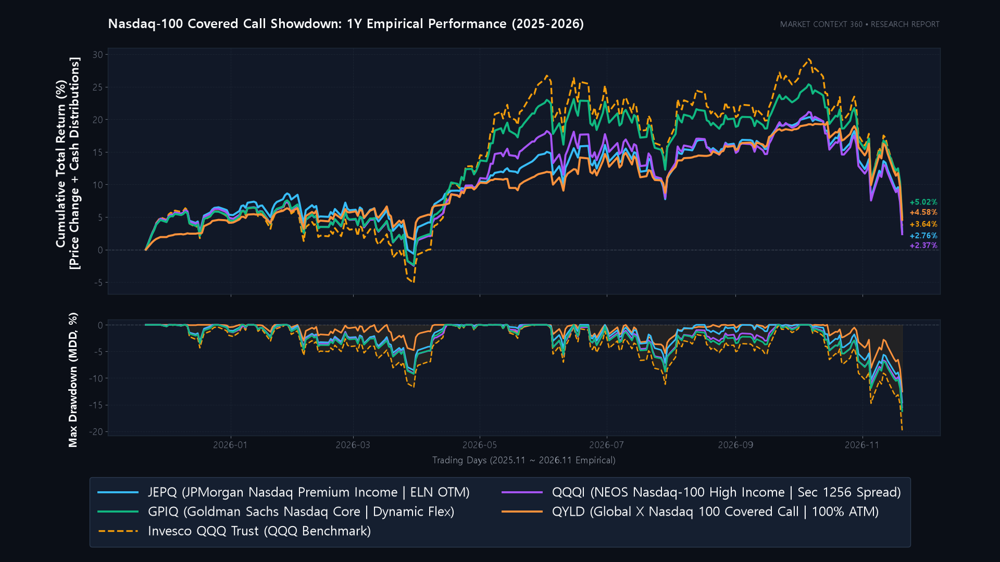
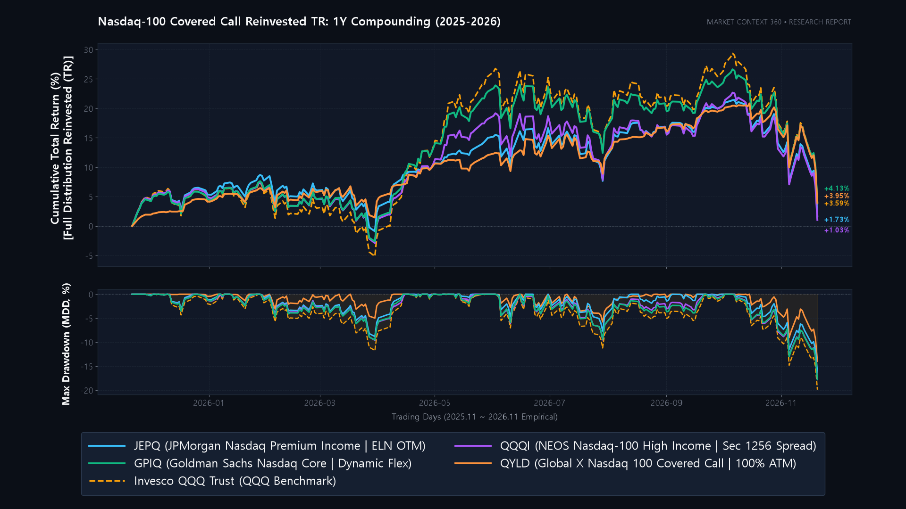

The Nasdaq-100 has historically served as Wall Street's premier engine of equity capital appreciation, driven by the structural dominance of megacap technology leaders. However, the relentless surge in institutional demand for cash flow has fueled an unprecedented expansion in tech-oriented systematic income strategies. Today, the Nasdaq-100 covered call landscape represents approximately $70 billion in cumulative assets under management (AUM), offering nominal distribution yields ranging from 9% to upwards of 15%.

For allocators, the central quantitative dilemma is straightforward: how much structural equity upside is surrendered in exchange for rich monthly option premiums? Over the 1-year empirical window spanning November 21, 2025 to November 20, 2026, the underlying tech benchmark navigated sharp micro-regime shifts, marked by high intraday volatility and multiple tech sector rotations. In this empirical study, we deconstruct and compare the four flagship systematic income vehicles—**JEPQ**, **QQQI**, **GPIQ**, and **QYLD**—against the benchmark **QQQ** across two synchronized holding scenarios: cash distribution hold versus full distribution compounding reinvestment.

---

## 1. Specification & Architectural Overview

While all four vehicles seek cash flow from the Nasdaq-100 index, their underlying mechanical architectures diverge significantly across portfolio construction, option structure, and overwrite intensity.

| Specification Metric | JEPQ (JPMorgan) | QQQI (NEOS) | GPIQ (Goldman Sachs) | QYLD (Global X) |
| :--- | :--- | :--- | :--- | :--- |
| **Ticker / CUSIP** | `JEPQ` (46641Q886) | `QQQI` (640798101) | `GPIQ` (381430503) | `QYLD` (37954Y483) |
| **Inception Date** | May 3, 2022 | Jan 30, 2024 | Oct 24, 2023 | Dec 11, 2013 |
| **Issuer / Sponsor** | J.P. Morgan Asset Management | NEOS Investments | Goldman Sachs Asset Management | Global X Management |
| **Underlying Index / Benchmark** | Nasdaq-100 Index / `QQQ` | Nasdaq-100 Index / `QQQ` | Nasdaq-100 Index / `QQQ` | Cboe Nasdaq-100 BuyWrite / `QQQ` |
| **Net Expense Ratio** | 0.35% | 0.68% | 0.35% | 0.60% |
| **AUM (Assets Under Mgt)** | ~$41.7B | ~$14.7B | ~$5.5B | ~$7.9B |
| **Underlying Equity Basket** | Fundamental Defensive Tech Basket | Full Nasdaq-100 Portfolio | Full Nasdaq-100 Replication | Full Nasdaq-100 Index Basket |
| **Option Overlay Mechanics** | Equity-Linked Notes (ELN) OTM Calls | Section 1256 NDX Call Spread | Dynamic Flex Overwrite (25%–75%) | 100% At-The-Money (ATM) Monthly Roll |
| **Target Distribution Yield** | ~9.5% – 11.0% | ~13.5% – 14.5% | ~9.0% – 9.5% | ~11.5% – 12.5% |
| **Realized 1Y Yield (Empirical)** | 12.36% ($1,235.78 / $10k) | 15.63% ($1,563.27 / $10k) | 11.30% ($1,129.78 / $10k) | 12.38% ($1,238.01 / $10k) |
| **Distribution Frequency** | Monthly | Monthly | Monthly | Monthly |
| **Currency / FX Exposure** | USD Unhedged (100% US Dollar) | USD Unhedged (100% US Dollar) | USD Unhedged (100% US Dollar) | USD Unhedged (100% US Dollar) |

---

## 2. 1-Year Empirical Performance Comparison (Charts & Summary Table)

To establish an institutional-grade assessment, we evaluate performance using synchronized daily close prices and exact cash distribution ledgers from November 21, 2025 to November 20, 2026 (251 consecutive trading sessions). We evaluate two synchronized scenarios with an identical initial investment of $10,000.

### ① [Set 1: Hold] Empirical Performance: Price Change + Cash Distributions

In the Hold scenario, distributions are collected as uninvested cash, mirroring the experience of income-focused investors who utilize distributions for operational liquidity.

*Figure 1: 1-Year Empirical Performance Comparison (Cash Distribution Hold Scenario: Initial $10,000 Capital). Click the chart to activate the interactive Pan & Zoom inspection stage (100% to 500% magnification).*

> 💡 **Hold Analysis Key Insight**: During a choppy, sideways market where the Nasdaq-100 benchmark (QQQ) generated +3.64% total return with a deep -19.82% maximum drawdown, systematic overwrite strategies demonstrated superior risk mitigation. **GPIQ** led the cohort with a **+5.02%** total return, followed by **QYLD (+4.58%)**, outperforming the raw benchmark while cutting maximum portfolio drawdowns by 3.5% to 7.3% percentage points.

| Strategy / Vehicle | Initial Capital ($) | Final Equity Value ($) | Pure Price Return (%) | Cash Distributions ($) | Final Total Wealth ($) | Cumulative Total Return (%) | Realized Yield (%) | Max Drawdown (MDD, %) | Sharpe Ratio (Annualized) |
| :--- | :---: | :---: | :---: | :---: | :---: | :---: | :---: | :---: | :---: |
| **GPIQ** (Goldman Sachs Core) | $10,000 | $9,372.67 | -6.27% | $1,129.78 | $10,502.45 | **+5.02%** | 11.30% | **-16.23%** | 0.36 |
| **QYLD** (Global X BuyWrite) | $10,000 | $9,220.10 | -7.80% | $1,238.01 | $10,458.12 | **+4.58%** | 12.38% | **-12.55%** | 0.39 |
| **JEPQ** (JPMorgan Equity Premium) | $10,000 | $9,039.82 | -9.60% | $1,235.78 | $10,275.60 | **+2.76%** | 12.36% | **-14.61%** | 0.25 |
| **QQQI** (NEOS High Income) | $10,000 | $8,673.64 | -13.26% | $1,563.27 | $10,236.92 | **+2.37%** | 15.63% | **-15.49%** | 0.22 |
| <strong style="color: #F59E0B;">Invesco QQQ Trust (QQQ Benchmark)</strong> | $10,000 | $10,311.49 | +3.11% | $52.38 | $10,363.87 | **+3.64%** | 0.52% | **-19.82%** | 0.27 |

---

### ② [Set 2: Reinvest TR] Empirical Performance: Compounding Distribution Reinvestment

In the Reinvestment scenario, all distributions are fully reinvested on each ex-dividend date at the closing NAV price, compounding the share count across the 1-year cycle. Benchmark QQQ is also synchronized on a total return (TR) compounding basis.

*Figure 2: 1-Year Compounding Empirical Performance (Full Distribution Reinvestment TR Scenario: Initial $10,000 Capital). Symmetrical dividend reinvestment applied to all vehicles and benchmark QQQ. Click the chart to activate interactive Pan & Zoom.*

> 💡 **Reinvest Analysis Key Insight**: Full distribution reinvestment during a volatile, oscillating market regime caused an observable performance drag across all covered call strategies relative to the Hold scenario.

| Strategy / Vehicle | Initial Capital ($) | Final Compounded Wealth ($) | Total Return (TR, %) | CAGR (TR Annualized) | Max Drawdown (TR MDD, %) | Sharpe Ratio (TR Annualized) | Drag vs Hold (Spread, %p) |
| :--- | :---: | :---: | :---: | :---: | :---: | :---: | :---: |
| **GPIQ** (Goldman Sachs Core) | $10,000 | $10,412.84 | **+4.13%** | +4.13% | -17.77% | 0.31 | **-0.90%p** |
| **QYLD** (Global X BuyWrite) | $10,000 | $10,395.17 | **+3.95%** | +3.95% | **-13.98%** | 0.33 | **-0.63%p** |
| **JEPQ** (JPMorgan Equity Premium) | $10,000 | $10,172.86 | **+1.73%** | +1.73% | -16.23% | 0.19 | **-1.03%p** |
| **QQQI** (NEOS High Income) | $10,000 | $10,102.90 | **+1.03%** | +1.03% | -17.64% | 0.15 | **-1.34%p** |
| <strong style="color: #F59E0B;">Invesco QQQ Trust (QQQ Benchmark TR)</strong> | $10,000 | $10,359.45 | **+3.59%** | +3.59% | **-19.90%** | 0.27 | **-0.04%p** |

---

## 3. Structural Decomposition: Why Did GPIQ and QYLD Outperform in 2026?

A granular inspection of the data reveals that performance diverged not by chance, but as a direct consequence of option overwrite architecture.

### ① Dynamic Flexibility vs Static Overwrite (GPIQ's Edge)
Goldman Sachs' **GPIQ** delivered the highest cumulative return in both scenarios (+5.02% Hold, +4.13% Reinvest). Unlike static 100% overwrite strategies, GPIQ modulates its coverage ratio dynamically between 25% and 75% using proprietary volatility and market regime indicators. When the Nasdaq-100 surged off local bottoms, GPIQ maintained an unencumbered equity posture on up to 75% of its portfolio, capturing essential upside that fully covered peers forfeited.

### ② The ATM Premium Buffer in Range-Bound Regimes (QYLD's Defense)
Conventional wisdom often cautions against **QYLD** due to its 100% ATM monthly call overwrite, which caps equity upside at 0% above the strike price. However, in a range-bound annual regime characterized by violent reversals rather than secular runaway bull trends, ATM options command the highest absolute extrinsic time value (theta). QYLD generated a resilient **12.38% realized cash yield** and achieved the lowest maximum drawdown (**-12.55%**) among all five vehicles.

### ③ ELN Structural Nuances and Defensive Stock Beta (JEPQ)
**JEPQ** pairs an actively managed, low-beta tech stock basket with equity-linked notes (ELNs) selling out-of-the-money (OTM) calls on the NDX index. While this defensive stock selection provides resilience during thematic tech corrections, the equity portfolio lagged the broader Nasdaq-100 mega-caps during aggressive AI-driven rallies, resulting in a +2.76% Hold total return.

### ④ High Nominal Yield vs Net Capital Erosion (QQQI)
**QQQI** achieved the highest realized cash yield at **15.63%** ($1,563.27 on a $10,000 base). Its Section 1256 call spread structure systematically buys an OTM call above the short strike to keep extreme right-tail upside open. However, purchasing the long call creates an ongoing option debit drag. In a chop market without massive parabolic extensions, the long wing expired unexercised, compounding NAV attrition and leading to a -13.26% pure price decline.

---

## 4. Tax Architecture: Section 1256 Contracts vs Ordinary Income

For taxable accounts, nominal returns only tell half the story. The internal tax treatment of cash distributions alters after-tax net wealth considerably.

1. **Section 1256 Contracts (QQQI Advantage)**: QQQI trades index call options on the NDX index, qualifying under Section 1256 of the Internal Revenue Code. Under this framework, 60% of option gains are taxed at favorable long-term capital gains rates and 40% at short-term capital gains rates, regardless of holding duration. Furthermore, NEOS actively utilizes distribution return of capital (ROC) accounting when applicable, potentially deferring immediate tax liabilities.
2. **Equity-Linked Notes (JEPQ Ordinary Income)**: Income generated through ELNs is generally treated as coupon income, taxed at ordinary income tax rates (up to 37% at the federal level), which can diminish net yield for high-bracket investors.
3. **Index Option Premium (QYLD ROC Treatment)**: QYLD has historically categorized a substantial portion of its monthly distributions as Return of Capital (ROC), reducing the investor's cost basis until the basis reaches zero, at which point further distributions are treated as capital gains.

---

## 5. Hold vs Reinvest: The Reverse Compounding Drag Phenomenon

The most critical mathematical takeaway from this 1-year empirical study is that **every single covered call ETF underperformed its own cash hold benchmark when distributions were reinvested**.

- **QQQI**: Hold +2.37% ➔ Reinvest +1.03% (**-1.34%p drag**)
- **JEPQ**: Hold +2.76% ➔ Reinvest +1.73% (**-1.03%p drag**)
- **GPIQ**: Hold +5.02% ➔ Reinvest +4.13% (**-0.90%p drag**)
- **QYLD**: Hold +4.58% ➔ Reinvest +3.95% (**-0.63%p drag**)
- **QQQ Benchmark**: Hold +3.64% ➔ Reinvest +3.59% (**-0.04%p drag**)

### The Mechanics of Reverse Compounding Drag

1. **Destruction of the Cash Cushion**: When an investor collects cash distributions during a cyclical market correction, that cash retains 100% of its nominal purchasing power. Reinvesting that cash into an ongoing downtrend subjects new shares to subsequent market declines.
2. **Asymmetric Payoff Ceiling**: In unconstrained equities like QQQ, dollar-cost averaging into dips accelerates compounding because the subsequent rebound carries unlimited upside. In covered call ETFs, the call option overwrite structurally truncates the rebound. Reinvested shares participate fully in subsequent dips, but their recovery is capped, mathematically entrenching the drag.

---

## 6. Portfolio Construction & Allocation Guidelines

Based on 1-year empirical evidence across varying market states:

* **For Tactical Income Seekers (Spend-from-Income)**: If your investment objective is direct cash flow consumption (such as retirement living expenses), the **Hold strategy** provides superior total wealth preservation and drawdown defense. **GPIQ** offers balanced market participation, while **QYLD** serves as a specialized theta capture vehicle in sideways channels.
* **For Accumulators & Wealth Builders**: If your horizon is long-term capital accumulation and distributions will simply be reinvested, covered call ETFs incur structural friction. Investors in the accumulation phase should consider deploying distributions into uncapped underlying benchmarks (such as QQQ or broad index funds) rather than compounding directly into call-constrained vehicles.

---

*Market Context 360 publishes weekly empirical research on systematic derivatives strategies, quantitative asset allocation, and exchange-traded fund architectures.*

---

## 📚 References & Regulatory Disclosures

> Source: U.S. Securities and Exchange Commission (SEC), Chicago Board Options Exchange (Cboe), JPMorgan Asset Management, NEOS Investments, Goldman Sachs Asset Management, Global X ETFs, Financial Industry Regulatory Authority (FINRA)

* [U.S. Securities and Exchange Commission (SEC)](https://www.sec.gov/edgar): Form N-PORT, Form N-CSR, and Statutory Prospectuses for JEPQ (CIK: 0001804196), QQQI (CIK: 0001844512), GPIQ (CIK: 0001479010), QYLD (CIK: 0001432353), and Invesco QQQ Trust (CIK: 0001067839).
* [Chicago Board Options Exchange (Cboe)](https://www.cboe.com): Cboe Nasdaq-100 BuyWrite Index (BXN) Benchmark Methodology, NDX Options Contract Specifications, and Volatility Index (VXN) Historical Metrics.
* [JPMorgan Asset Management](https://am.jpmorgan.com): JPMorgan Nasdaq Equity Premium Income ETF (JEPQ) Distribution History, Equity-Linked Note (ELN) Counterparty Credit Risk Disclosures, and Portfolio Holdings.
* [NEOS Investments](https://neosfunds.com): NEOS Nasdaq 100 High Income ETF (QQQI) Section 1256 Tax Treatment, Call Spread Collar Mechanics, and Monthly Distribution History.
* [Goldman Sachs Asset Management](https://www.gsam.com): Goldman Sachs Nasdaq-100 Core Premium Income ETF (GPIQ) Dynamic Flex Overwrite Framework and Rules-Based Volatility Scaling Rules.
* [Global X ETFs](https://www.globalxetfs.com): Global X Nasdaq 100 Covered Call ETF (QYLD) Summary Prospectus and Cboe BXN Passive Replication Mechanics.
* [Financial Industry Regulatory Authority (FINRA)](https://www.finra.org): FINRA Rule 2210 Communications with the Public Regarding Options and Structured Derivatives.

---

## Legal & Regulatory Compliance Disclaimer

> **SEC / FINRA Legal Disclaimer**:  
> This publication is strictly for informational, educational, and research purposes and does not constitute financial, investment, legal, or tax advice. No statement herein should be construed as an offer to sell, a solicitation of an offer to buy, or a recommendation for any security, portfolio, or strategy. Past performance is no guarantee of future results. All investments involve risk, including the possible loss of principal. Options trading involves substantial risk and is not suitable for all investors. Investors must conduct independent due diligence and consult a qualified, licensed financial advisor before making any investment decision.

---

  <strong>Regulatory Compliance &amp; Legal Disclaimer:</strong> 
  <em>Market Context 360 is an independent financial research publication providing impersonal macroeconomic, quantitative, and technical analysis for educational purposes only. The information presented herein does not constitute individualized investment advice, financial planning, or a recommendation or solicitation to buy, sell, or hold any security, commodity, or investment product. Market Context 360 is not a Registered Investment Adviser (RIA), broker-dealer, or fiduciary under the U.S. Investment Advisers Act of 1940 or FINRA regulations. Historical backtests, quantitative frameworks, and empirical models are hypothetical, educational, and subject to substantial market risks, including the potential loss of principal. Readers must exercise independent judgment and consult with a licensed, fiduciary financial advisor before executing any capital allocation decisions.</em>

