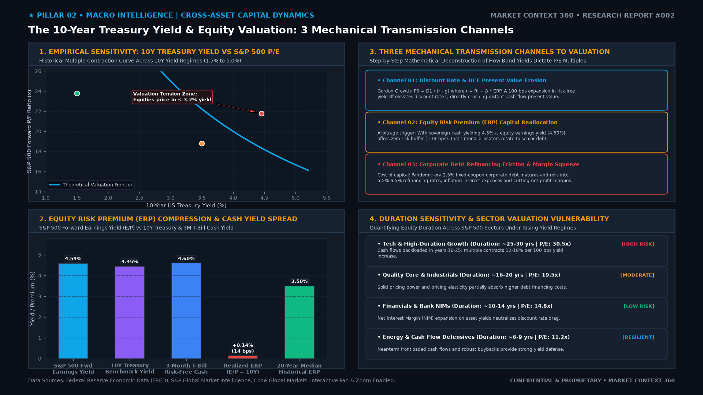

Across modern capital markets, the 10-Year U.S. Treasury note represents the foundational risk-free discount rate against which all financial assets are priced. Over the past four decades, institutional allocators grew accustomed to a structural secular decline in sovereign bond yields, which culminated in the Zero Interest Rate Policy (ZIRP) era. During that multi-year regime, nominal 10-year yields below 2.0% justified equity valuation multiples expanding well beyond historical norms.

However, the macroeconomic regime that took hold across 2024 to 2026 has established a fundamentally different baseline. Driven by sustained fiscal debt issuance, resilient nominal gross domestic product, and the Federal Reserve's balance sheet normalization (Quantitative Tightening), the 10-Year Treasury yield has anchored in the 4.40% to 4.65% band. 

Despite this seismic shift in the risk-free rate of return, the S&P 500 benchmark trades near 21.8x forward consensus earnings. For cross-asset portfolio managers and quantitative allocators, this pricing dynamic creates an acute mathematical friction. Equity price-to-earnings multiples are not arbitrary sentiment indices; they represent the discounted present value of expected cash flow streams. When the baseline discount rate rises by more than 300 basis points, the mechanical laws of asset pricing dictate observable constraints on equity multiple expansion.

In this research report, we examine the quantitative architecture governing the relationship between long-term sovereign bond yields and equity valuations, deconstructing the three primary transmission mechanisms that govern S&P 500 pricing multiples.

---

## 1. The Three Mechanical Transmission Channels

The causal transmission from rising benchmark Treasury yields to equity valuation operates through three distinct structural channels: discount rate mathematics, asset allocation arbitrage, and corporate cost of capital.

```
┌────────────────────────────────────────────────────────────────────────────────────────┐
│               THREE TRANSMISSION CHANNELS: 10Y TREASURY YIELD ➔ EQUITY VALUATION       │
├──────────────────────────┬──────────────────────────┬──────────────────────────────────┤
│ Transmission Channel     │ Primary Pricing Driver   │ Mechanical Valuation Impact      │
├──────────────────────────┼──────────────────────────┼──────────────────────────────────┤
│ ① Discount Rate Channel  │ Capital Asset Pricing    │ Gordon Growth denominator        │
│    (DCF Valuation)       │ Model (CAPM) / WACC      │ expands: P0 = D1 / (r - g)       │
├──────────────────────────┼──────────────────────────┼──────────────────────────────────┤
│ ② Risk Premium Channel   │ Relative Asset Yields    │ Equity Risk Premium collapses;   │
│    (Asset Allocation)    │ (E/P minus Y_10Y)        │ Institutional flight to senior   │
│                          │                          │ sovereign cash assets            │
├──────────────────────────┼──────────────────────────┼──────────────────────────────────┤
│ ③ Corporate Debt Channel │ Corporate Refinancing &  │ Effective borrowing rates rise;  │
│    (Earnings Friction)   │ Net Interest Expense     │ Interest coverage drops, cutting │
│                          │                          │ net income margin conversion     │
└──────────────────────────┴──────────────────────────┴──────────────────────────────────┘
```

### ① Channel 1: Discount Rate Mechanics & DCF Valuation Compression

The direct theoretical link between interest rates and stock valuations is derived from the Dividend Discount Model and discounted cash flow (DCF) frameworks. Under the classic Gordon Growth formulation:

$$P_0 = \frac{D_1}{r - g}$$

Where:
- $P_0$ represents the intrinsic value of the equity asset,
- $D_1$ represents next period expected dividends or free cash flow,
- $r$ represents the required rate of return (equity discount rate),
- $g$ represents the perpetual expected growth rate of cash flows.

The required rate of return $r$ is formulated via the Capital Asset Pricing Model (CAPM):

$$r = R_f + \beta \times (\text{ERP})$$

Where $R_f$ is the risk-free rate (proxied by the 10-Year Treasury yield), $\beta$ is market beta, and $\text{ERP}$ is the Equity Risk Premium. 

When the 10-Year Treasury yield ($R_f$) rises from 1.50% to 4.50%, the baseline required discount rate $r$ shifts upward by 300 basis points. Assuming an equity risk premium of 3.00% and a perpetual long-run growth rate $g$ of 2.00%:
- Under a 1.50% risk-free rate: $r = 1.50\% + 3.00\% = 4.50\%$. The valuation spread $(r - g) = 4.50\% - 2.00\% = 2.50\%$, yielding an implied theoretical multiple of $\frac{1}{0.025} = 40.0\text{x}$.
- Under a 4.50% risk-free rate: $r = 4.50\% + 3.00\% = 7.50\%$. The valuation spread $(r - g) = 7.50\% - 2.00\% = 5.50\%$, yielding an implied theoretical multiple of $\frac{1}{0.055} = 18.18\text{x}$.

This mathematical reality highlights an unavoidable truth: holding perpetual cash flow growth ($g$) constant, an expansion in the baseline risk-free rate widens the denominator, mechanically forcing equilibrium valuation multiples to contract.

### ② Channel 2: The Equity Risk Premium (ERP) Arbitrage & Cash Competition

The second transmission channel operates through cross-asset portfolio allocation. Multi-asset institutional investors continuously compare the earnings yield of equities against risk-free sovereign paper.

The Equity Risk Premium (ERP) on a forward basis is defined as:

$$\text{ERP} = \left(\frac{E_1}{P_0}\right) - Y_{10Y}$$

Where:
- $\frac{E_1}{P_0}$ represents the forward earnings yield of the S&P 500 (the mathematical inverse of the forward P/E ratio),
- $Y_{10Y}$ represents the nominal yield on the 10-Year U.S. Treasury note.

With the S&P 500 trading at 21.8x forward consensus earnings, the aggregate earnings yield stands at:

$$\text{Earnings Yield} = \frac{1}{21.8} \approx 4.59\%$$

Simultaneously, the 10-Year Treasury note yields approximately 4.45%, while 3-Month Treasury bills provide a sovereign cash yield of 4.60%. Consequently:

$$\text{Forward ERP} = 4.59\% - 4.45\% = +0.14\%\; (+14\text{ bps})$$

Historically, over the 20-year span from 2004 to 2024, the realized equity risk premium for the S&P 500 averaged roughly 350 basis points (+3.50%). A spread of only 14 basis points represents an extreme statistical outlier, situated near the lowest decile of empirical history.

```
Short-Term Sovereign Cash (3M T-Bills): 4.60%  [Senior Claim, Sovereign-Backed Yield]
Benchmark Sovereign Debt (10Y UST):     4.45%  [Full Faith & Credit of U.S. Government]
S&P 500 Forward Earnings Yield (21.8x): 4.59%  [Junior Residual Claim, Volatile Equity Risk]
────────────────────────────────────────────────────────────────────────────────────────
Realized Equity Risk Compensation:      +0.14% (+14 bps) ➔ Statistically Compressed Buffer
```

When liquid sovereign paper provides benchmark yields above 4.50%, institutional asset allocators face a compelling substitution incentive. Capital reallocation from equities to fixed income accelerates as the incremental return for bearing corporate equity volatility declines toward zero.

### ③ Channel 3: Corporate Debt Refinancing Friction & Margin Compression

The third transmission mechanism operates directly on corporate earnings generation through balance sheet capital structures. 

During the 2020 to 2021 period, non-financial corporate issuers capitalized on low interest rates by issuing hundreds of billions of dollars in long-dated senior notes with fixed coupons averaging between 2.25% and 3.50%. This corporate liability management insulated income statements from the initial phase of Federal Reserve monetary tightening.

However, corporate debt maturity profiles are not infinite. Over $1.8 trillion in corporate bonds and syndicated institutional loans are scheduled to mature between 2025 and 2027. When companies refinance maturing 3.0% paper into prevailing corporate borrowing environments of 5.50% to 6.75%, the interest expense burden expands substantially:

$$\Delta \text{Interest Expense} = \text{Debt Refinanced} \times (r_{\text{new}} - r_{\text{old}})$$

For an enterprise with $10 billion in debt facing a 300 basis point refinancing spread, annual pretax interest expense increases by $300 million. This structural increase in debt service costs reduces net income margins, lowering earnings per share ($E_1$) and elevating the effective price-to-earnings multiple even in the absence of stock price changes.

---

## 2. Visual Transmission Architecture

The infographic below illustrates the multi-layered transmission framework, connecting empirical yield sensitivity curves, compressed risk premiums, and sector-by-sector duration vulnerabilities.



> 💡 **Macro Regime Key Insight**: With the 10-Year Treasury yield trading near 4.45% and the S&P 500 forward P/E at 21.8x, the Equity Risk Premium has compressed to just 14 basis points—far below its 20-year median of 350 basis points. In this regime, equities are priced as though bond yields were below 3.20%, leaving multiples sensitive to further rate pressures.

---

## 3. Empirical Sensitivity Matrix: Yield Regimes vs. Multiple Ceilings

To understand the mathematical boundaries governing equity pricing, we analyze a deterministic valuation sensitivity matrix. The model holds 2026 consensus normalized S&P 500 earnings per share at $275.00, evaluating theoretical fair value multiples across varying 10-Year Treasury yield environments and target risk premiums.

| 10Y UST Yield ($Y_{10Y}$) | Target ERP Spread | Required Earnings Yield ($E/P$) | Implied Fair P/E Multiple | Theoretical S&P 500 Index Level | Valuation Deviation vs. Current (21.8x) | Macro Regime Classification |
| :---: | :---: | :---: | :---: | :---: | :---: | :--- |
| **2.00%** | +2.50% | 4.50% | **22.2x** | 6,105 | +1.8% | ZIRP / Pandemic Stimulus Era |
| **3.00%** | +2.00% | 5.00% | **20.0x** | 5,500 | -8.3% | Moderate Neutral Benchmark |
| **3.50%** | +2.00% | 5.50% | **18.2x** | 5,005 | -16.5% | Cyclical Trendline Norm |
| **4.00%** | +1.75% | 5.75% | **17.4x** | 4,785 | -20.2% | Early Higher-for-Longer Regime |
| **4.45% (Current)** | +1.50% | 5.95% | **16.8x** | 4,620 | -22.9% | Strict Historic Valuation Baseline |
| **4.45% (Current)** | **+0.14%** | **4.59%** | **21.8x** | **6,000** | **0.0% (Current Market Reality)** | **Extreme ERP Compression Regime** |
| **5.00%** | +1.50% | 6.50% | **15.4x** | 4,235 | -29.4% | Severe Deficit / Term Premium Shock |
| **5.50%** | +1.50% | 7.00% | **14.3x** | 3,932 | -34.4% | 1990s Restrictive Macro Regime |

### Deconstructing the Matrix Findings

1. **The Magnitude of Valuation Distortion**: If the S&P 500 were priced to reflect a modest equity risk premium of +150 basis points above the current 4.45% Treasury yield, the equilibrium earnings yield would equal 5.95%. This equates to an equilibrium P/E multiple of 16.8x, representing an index fair value near 4,620.
2. **The Growth Expectation Offset**: The current market price of 21.8x P/E can be justified under capital asset pricing models only if cash flow growth expectations ($g$) have risen significantly, primarily driven by anticipated artificial intelligence productivity gains, or if market participants anticipate rapid, sustained Federal Reserve rate cuts down to 3.00%.
3. **Asymmetric Risk-Return Profile**: If 10-year yields rise further toward 5.00% due to expanded Treasury debt auction supply, the mathematical pressure toward 15.4x–16.5x multiples increases considerably.

---

## 4. Equity Duration Decompilation: Sector Vulnerability Analysis

Just as fixed-income securities exhibit varying sensitivity to interest rate shifts based on their bond duration, equities possess an intrinsic **Equity Duration** determined by the timing of their expected cash flow distributions.

The mathematical formulation for equity duration is approximately expressed as:

$$D_{\text{equity}} \approx \frac{1 + r - g}{r - g} \approx \left(\frac{P_0}{E_1}\right) \times \text{CF Retention Factor}$$

Companies with high current cash distributions exhibit short duration, whereas growth companies whose enterprise value depends heavily on cash flows projected 15 to 25 years into the future exhibit long equity duration.

```
┌────────────────────────────────────────────────────────────────────────────────────────┐
│                        EQUITY DURATION & RATE SENSITIVITY CONTINUUM                    │
├────────────────────────────────────────────────────────────────────────────────────────┤
│ [Short Duration: 6 - 12 Yrs]       [Moderate: 14 - 20 Yrs]    [Long Duration: 24 - 30+ Yrs]
│ Energy & Materials                 Financials & Industrials   Tech & Megacap Growth    │
│ Near-term FCF yield: 8-10%         Cash flows evenly spread   Cash flows back-loaded   │
│ Low Multiple: 10x - 14x            Core Multiple: 16x - 20x   Premium Multiple: 28x - 35x
│ Minimally Sensitive to Yields      Moderate Rate Absorption   Highly Sensitive to Yields
└────────────────────────────────────────────────────────────────────────────────────────┘
```

### Detailed Sector Breakdown

### ① Technology & High-Duration Growth (High Risk)
- **Implied Duration**: 24 to 30 years
- **Current Sector Multiple**: ~30.5x Forward P/E
- **Mechanism**: For enterprise software and emerging technology leaders, a substantial portion of enterprise value resides in terminal value calculations. When discount rates rise, the mathematical present value of cash flows expected in 2035 or 2040 contracts sharply. Empirically, each 100 basis point increase in real 10-year yields corresponds to an approximate 12% to 18% multiple de-rating across non-dividend-paying growth equities.

### ② Quality Core & Industrials (Moderate Risk)
- **Implied Duration**: 16 to 20 years
- **Current Sector Multiple**: ~19.5x Forward P/E
- **Mechanism**: Established industrial and consumer manufacturing businesses generate consistent operating cash flows throughout the business cycle. Strong pricing power enables these companies to pass along input costs, partially offsetting higher discount rates through nominal earnings growth.

### ③ Financials & Commercial Banking (Low Risk / Net Beneficiary)
- **Implied Duration**: 10 to 14 years
- **Current Sector Multiple**: ~14.8x Forward P/E
- **Mechanism**: Commercial banking institutions possess asset-sensitive balance sheets. Higher yields across the intermediate and long segments of the Treasury curve widen Net Interest Margins (NIM), supporting earnings capacity and cushioning equity multiples against broader discount rate pressures.

### ④ Energy & Infrastructure Cash Cows (Resilient)
- **Implied Duration**: 6 to 9 years
- **Current Sector Multiple**: ~11.2x Forward P/E
- **Mechanism**: Major integrated energy and infrastructure providers return capital directly to shareholders through dividend yields and share repurchases. Because cash returns are realized in the immediate term rather than the distant future, discount rate fluctuations exert minimal valuation drag on these shares.

---

## 5. Institutional Portfolio Positioning Implications

In a macroeconomic regime characterized by 4.40% to 4.75% 10-Year Treasury yields, passive equity indexing faces distinct structural headwinds compared to the previous decade. Institutional allocators frequently employ three specific portfolio construction principles to navigate this environment:

1. **Balance-Sheet Self-Funding Verification**: Screen equity holdings rigorously for net debt-to-EBITDA ratios below 1.5x and positive free cash flow yields exceeding 5.0%. Companies that fund capital expenditures and dividends out of organic operating cash flow remain insulated from the corporate debt refinancing wave.
2. **Barbell Asset Allocation Framework**: Rather than maintaining a standard 60/40 equity-to-bond portfolio, allocators pair high-conviction secular growth companies that possess clear software pricing power with short-duration cash equivalents (such as 3-Month T-Bills yielding 4.60%). This barbell structure captures upside from technological innovation while generating steady sovereign cash income.
3. **Yield Threshold Monitoring**: Multi-asset models indicate that if the 10-Year Treasury yield decisively breaches 4.75% to 5.00%, systematic risk-parity funds and CTA algorithms face automated equity de-risking triggers. Institutional risk desks treat 4.75% as a critical line of defense for aggregate equity multiple stability.

---

## Legal & Regulatory Compliance Disclaimer

> **SEC / FINRA Legal Disclaimer**:  
> This publication is strictly for informational, educational, and research purposes and does not constitute financial, investment, legal, or tax advice. No statement herein should be construed as an offer to sell, a solicitation of an offer to buy, or a recommendation for any security, portfolio, or strategy. Past performance is no guarantee of future results. All investments involve risk, including the possible loss of principal. Equity and bond investments are subject to market risk, interest rate risk, credit risk, and economic volatility. Investors must conduct independent due diligence and consult a qualified, licensed financial advisor before making any investment decision.

---

<div class="post-disclaimer">
  <strong>Regulatory Compliance &amp; Legal Disclaimer:</strong><br>
  <em>Market Context 360 is an independent financial research publication providing impersonal macroeconomic, quantitative, and technical analysis for educational purposes only. The information presented herein does not constitute individualized investment advice, financial planning, or a recommendation or solicitation to buy, sell, or hold any security, commodity, or investment product. Market Context 360 is not a Registered Investment Adviser (RIA), broker-dealer, or fiduciary under the U.S. Investment Advisers Act of 1940 or FINRA regulations. Historical valuations, discounted cash flow frameworks, sensitivity models, and empirical analyses are hypothetical, educational, and subject to substantial market risks, including the potential risk of loss of principal. Readers must exercise independent judgment and consult with a licensed, fiduciary financial advisor before executing any capital allocation decisions.</em>
</div>
