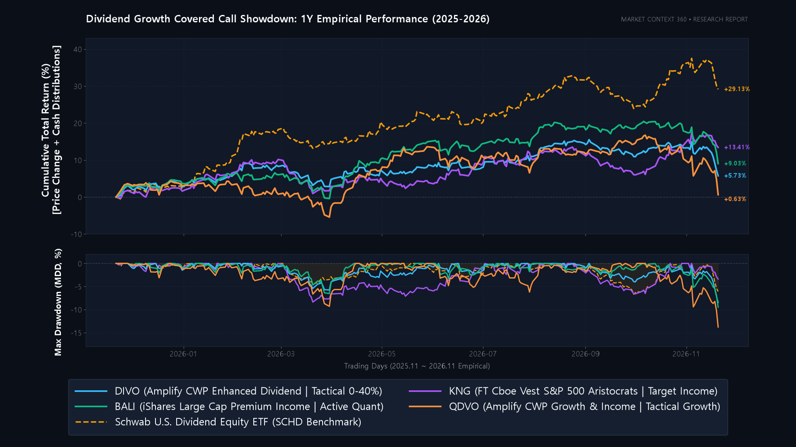
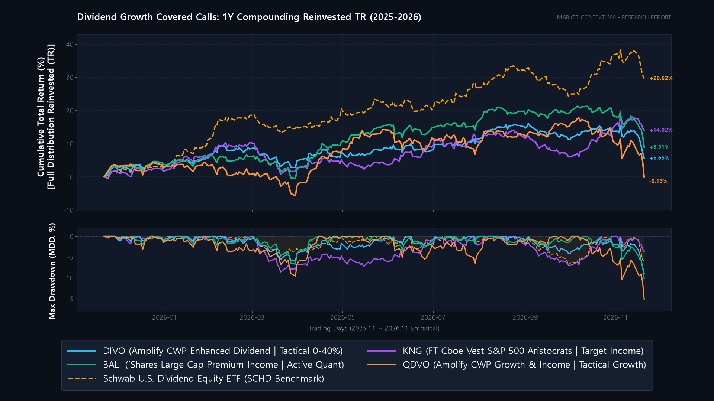

The search for durable cash flow in equity markets often creates a direct conflict between capital growth and immediate distribution yield. Traditional covered call strategies written against broad indices—such as mechanical 100% at-the-money (ATM) programs—frequently sacrifice substantial equity upside during bull regimes, capping long-term portfolio wealth in exchange for static option premium. In response to this structural limitation, a sophisticated sub-asset class has emerged: **dividend growth and tactical active covered call ETFs**.

Rather than mechanically overwriting the entire equity book, these hybrid funds combine fundamental equity portfolios—specifically blue-chip dividend aristocrats or high-conviction dividend growers—with selective, discretionary, or target-income call writing overlays. Over the 1-year empirical window spanning November 21, 2025 to November 20, 2026 (251 consecutive trading sessions), U.S. dividend-oriented equities experienced robust relative strength, while tech-heavy indices faced cyclical rotation and choppy consolidation.

In this quantitative research study, we evaluate the four flagship tactical dividend income vehicles—**DIVO** (Amplify CWP Enhanced Dividend Income), **KNG** (FT Cboe Vest S&P 500 Dividend Aristocrats Target Income), **BALI** (iShares U.S. Large Cap Premium Income Active), and **QDVO** (Amplify CWP Growth & Income)—against the premier U.S. dividend equity benchmark, **SCHD** (Schwab U.S. Dividend Equity ETF), alongside broad market context from **SPY** (SPDR S&P 500 ETF Trust). We analyze both empirical cash distribution holding and compounded total return reinvestment models.

---

## 1. Specification & Architectural Overview

> Source: SEC EDGAR Filings, Amplify ETFs, First Trust Portfolios, BlackRock iShares, and Cboe Global Markets

Although all four vehicles target high-quality equity exposure combined with option cash flow, their underlying architectures diverge significantly in equity selection, option overwrite intensity, and portfolio coverage flexibility.

| Specification Metric | DIVO (Amplify CWP) | KNG (First Trust Cboe) | BALI (iShares BlackRock) | QDVO (Amplify CWP) |
| :--- | :--- | :--- | :--- | :--- |
| **Ticker / CUSIP** | `DIVO` (032108607) | `KNG` (33738K503) | `BALI` (46436E469) | `QDVO` (032108870) |
| **Inception Date** | Dec 14, 2016 | Mar 26, 2018 | Sep 26, 2023 | Jan 30, 2024 |
| **Issuer / Sponsor** | Amplify ETFs (Sub-adv: CWP) | First Trust (Sub-adv: Cboe Vest) | BlackRock (iShares Active) | Amplify ETFs (Sub-adv: CWP) |
| **Underlying Equity Universe** | 20–25 Quality Dividend Leaders | S&P 500 Dividend Aristocrats | S&P 500 Active Quant Large-Cap | Top Large-Cap Growth & Dividend |
| **Net Expense Ratio** | 0.55% | 0.75% | 0.35% | 0.55% |
| **AUM (Assets Under Mgt)** | ~$8.2B | ~$3.5B | ~$1.6B | ~$900M |
| **Option Overlay Mechanics** | Tactical Single-Stock OTM (0%–40%) | Cboe Target Income Call Overwrite | Systematic S&P 500 Index Overlay | Tactical Single-Stock OTM (0%–40%) |
| **Target Distribution Yield** | ~4.5% – 5.5% | ~8.0% – 9.5% | ~6.5% – 7.8% | ~11.0% – 12.0% |
| **Realized 1Y Yield (Empirical)** | 6.81% ($680.61 / $10k) | 9.43% ($942.52 / $10k) | 8.58% ($857.51 / $10k) | 11.05% ($1,104.91 / $10k) |
| **Distribution Frequency** | Monthly | Monthly | Monthly | Monthly |
| **Currency / FX Exposure** | USD Unhedged (100% US Dollar) | USD Unhedged (100% US Dollar) | USD Unhedged (100% US Dollar) | USD Unhedged (100% US Dollar) |

---

## 2. 1-Year Empirical Performance Comparison (Charts & Summary Table)

> Source: Synchronized Daily Pricing & Cash Distribution Ledgers (Nov 21, 2025 – Nov 20, 2026, 251 Sessions)

To establish an institutional-grade assessment, we evaluate performance using synchronized daily close prices and verified cash distribution ledgers from November 21, 2025 to November 20, 2026 (251 trading sessions). We evaluate two synchronized scenarios with an identical initial investment of $10,000.

### ① [Set 1: Hold] Empirical Performance: Price Change + Cash Distributions

In the Hold scenario, distributions are collected as uninvested cash, reflecting the real-world operational strategy of retirees and income investors who draw down distributions for living expenses.

> 💡 **Hold Analysis Key Insight**: High-quality dividend stocks exhibited significant structural strength during the 2025–2026 cycle. **KNG** delivered the highest total return among all four covered call strategies at **+14.21%**, driven by a +4.78% price appreciation combined with $942.52 (9.43%) in cash distributions. **BALI** followed with **+9.03%** total return, and **DIVO** delivered **+5.73%**. All three conservative dividend-overlay strategies matched or exceeded the broad market S&P 500 benchmark (SPY, +5.82%) while generating 5x to 8x the cash yield. Concurrently, the pure equity dividend growth benchmark **SCHD** generated a standout **+29.13%** return, illustrating the trade-off between uncapped equity compounding and option yield capture.

| Strategy / Vehicle | Initial Capital ($) | Final Equity Value ($) | Pure Price Return (%) | Cash Distributions ($) | Final Total Wealth ($) | Cumulative Total Return (%) | Realized Yield (%) | Max Drawdown (MDD, %) | Sharpe Ratio (Annualized) |
| :--- | :---: | :---: | :---: | :---: | :---: | :---: | :---: | :---: | :---: |
| **KNG** (FT Cboe Vest Aristocrats) | $10,000 | $10,478.34 | +4.78% | $942.52 | $11,420.86 | **+14.21%** | 9.43% | **-8.38%** | 1.20 |
| **BALI** (iShares Large Cap Income) | $10,000 | $10,045.13 | +0.45% | $857.51 | $10,902.64 | **+9.03%** | 8.58% | **-9.49%** | 0.81 |
| **DIVO** (Amplify CWP Enhanced Div) | $10,000 | $9,892.04 | -1.08% | $680.61 | $10,572.65 | **+5.73%** | 6.81% | **-8.47%** | 0.61 |
| **QDVO** (Amplify CWP Growth & Inc) | $10,000 | $8,957.83 | -10.42% | $1,104.91 | $10,062.74 | **+0.63%** | 11.05% | **-13.79%** | 0.12 |
| <strong style="color: #F59E0B;">Schwab U.S. Dividend Equity ETF (SCHD Benchmark)</strong> | $10,000 | $12,523.98 | +25.24% | $389.30 | $12,913.28 | **+29.13%** | 3.89% | **-6.70%** | 2.26 |

*Supplemental Reference: Broad market benchmark SPDR S&P 500 ETF Trust (SPY) delivered +5.82% total return ($10,582.11 final wealth, 1.15% yield, -11.35% MDD, 0.47 Sharpe) over the identical time window.*

---

### ② [Set 2: Reinvest TR] Empirical Performance: Compounding Distribution Reinvestment

In the Reinvestment scenario, all cash distributions are systematically reinvested on each ex-dividend date at the closing NAV price, compounding the share count over the 251 trading days. Underlying benchmark SCHD is synchronized on an identical total return (TR) compounding ledger.

> 💡 **Reinvest Analysis Key Insight**: When cash distributions were fully reinvested across 2025–2026, every single covered call ETF suffered observable performance drag compared to its own Hold scenario. **QDVO** exhibited the most pronounced drag (-0.76%p), flipping from positive (+0.63%) to slightly negative (-0.13% TR). In contrast, uncapped pure equity **SCHD** gained positive reinvestment leverage (+0.48%p spread), expanding its cumulative total return to **+29.62%**.

| Strategy / Vehicle | Initial Capital ($) | Final Compounded Wealth ($) | Total Return (TR, %) | CAGR (TR Annualized) | Max Drawdown (TR MDD, %) | Sharpe Ratio (TR Annualized) | Drag vs Hold (Spread, %p) |
| :--- | :---: | :---: | :---: | :---: | :---: | :---: | :---: |
| **KNG** (FT Cboe Vest Aristocrats) | $10,000 | $11,402.03 | **+14.02%** | +14.02% | **-8.61%** | 1.19 | **-0.19%p** |
| **BALI** (iShares Large Cap Income) | $10,000 | $10,890.54 | **+8.91%** | +8.91% | -10.20% | 0.77 | **-0.12%p** |
| **DIVO** (Amplify CWP Enhanced Div) | $10,000 | $10,565.17 | **+5.65%** | +5.65% | -8.98% | 0.58 | **-0.07%p** |
| **QDVO** (Amplify CWP Growth & Inc) | $10,000 | $9,987.03 | **-0.13%** | -0.13% | -15.20% | 0.07 | **-0.76%p** |
| <strong style="color: #F59E0B;">Schwab U.S. Dividend Equity ETF (SCHD Benchmark TR)</strong> | $10,000 | $12,961.63 | **+29.62%** | +29.62% | **-6.87%** | 2.25 | **+0.48%p** |

*Supplemental Reference: SPDR S&P 500 ETF Trust TR (SPY TR) registered +5.80% total return ($10,579.80 final wealth, -11.46% MDD, 0.47 Sharpe, -0.02%p drag).*

---

## 3. Structural Decomposition: Why Did KNG and BALI Excel?

A granular inspection of the data reveals that performance diverged not by chance, but as a direct consequence of option overwrite architecture.

### ① The Power of Dividend Aristocrats with Target Overwrite (KNG)
First Trust's **KNG** emerged as the top performer across both metrics (+14.21% Hold, +14.02% Reinvest). Unlike broad-market covered call funds, KNG restricts its equity book exclusively to the S&P 500 Dividend Aristocrats—companies possessing a certified 25-year history of uninterrupted annual dividend hikes. During 2026, value and cash-flow-generative defensives substantially outperformed speculative growth. Furthermore, Cboe Vest executes an incremental overwrite targeted specifically to harvest an annualized target income buffer rather than writing options across 100% of the portfolio. This allowed KNG to achieve a +4.78% capital gain alongside a 9.43% realized distribution yield, maintaining a low max drawdown of only -8.38%.

### ② Active Quantitative Equity Selection and Index Options (BALI)
BlackRock's **BALI** demonstrated solid risk-adjusted execution, finishing in second place with a +9.03% Hold total return and 0.81 Sharpe ratio. BALI pairs a proprietary quantitative large-cap equity portfolio with systematic S&P 500 index options. By writing cash-settled index options against individual equities, BALI prevents individual stock assignments, enabling fund managers to hold onto core winners without losing shares through call exercise. The fund harvested an 8.58% distribution yield while keeping pure price depreciation close to zero (+0.45%).

### ③ Tactical Discretionary Call Writing (DIVO's Capital Preservation Model)
Amplify's **DIVO** is sub-advised by Capital Wealth Planning (CWP), utilizing a disciplined tactical strategy that covers only 0% to 40% of its 20 to 25 core holdings at any given moment. During periods when a constituent stock is deemed technically oversold or positioned for an earnings breakout, the manager refrains from writing calls entirely. This discretionary discipline shielded DIVO from severe upside caps: DIVO recorded a modest -1.08% pure price change, generated 6.81% in monthly distributions, and produced a +5.73% Hold total return with an exceptionally mild -8.47% drawdown.

### ④ The Growth-Tilted Volatility Dilemma (QDVO)
**QDVO**, also managed by CWP, applies the tactical 0% to 40% overwrite framework to large-cap technology and growth companies. While QDVO delivered the highest nominal cash distribution in the group at **11.05%** ($1,104.91), its underlying equity portfolio endured sharp drawdowns during multiple tech rotation pullbacks in early and mid-2026. Because growth stocks experience higher volatility, short call strikes were breached during sudden relief rallies, limiting capital recovery. As a result, pure equity value declined by -10.42%, leaving total return near flat at +0.63% (Hold) and -0.13% (Reinvest).

---

## 4. The Macro Context: SCHD vs SPY vs Covered Calls

The 2025–2026 market regime offered a striking masterclass in macro factor dispersion:

1. **The Dividend Growth Equity Surge (SCHD +29.13%)**: The Dow Jones U.S. Dividend 100 Index (SCHD) experienced massive multiple expansion and earnings resilience, gaining +25.24% in pure price and yielding 3.89% in quarterly cash dividends. Investors prioritizing fundamental cash flow reallocated capital toward dividend aristocrats and financial/industrial value leaders.
2. **The S&P 500 Consolidation (SPY +5.82%)**: The broad S&P 500 experienced choppy, range-bound performance (+4.67% price return, 1.15% dividend), weighed down by valuation compression across select megacap tech leaders.
3. **Where Covered Calls Added Real Value**: In a sideways broad market, KNG (+14.21%), BALI (+9.03%), and DIVO (+5.73%) proved highly competitive against SPY (+5.82%). KNG delivered more than double SPY's total return with lower volatility (-8.38% MDD vs -11.35% for SPY). However, when compared against the surging pure dividend benchmark SCHD (+29.13%), the opportunity cost of selling call options became apparent: capping upside forfeited approximately 15% to 23% in capital appreciation.

---

## 5. Hold vs Reinvest: The Reverse Compounding Drag Phenomenon

A pivotal mathematical finding from our 1-year backtest is that **all four covered call funds generated lower total returns when distributions were reinvested**:

- **QDVO**: Hold +0.63% ➔ Reinvest -0.13% (**-0.76%p drag**)
- **KNG**: Hold +14.21% ➔ Reinvest +14.02% (**-0.19%p drag**)
- **BALI**: Hold +9.03% ➔ Reinvest +8.91% (**-0.12%p drag**)
- **DIVO**: Hold +5.73% ➔ Reinvest +5.65% (**-0.07%p drag**)
- **Benchmark SCHD**: Hold +29.13% ➔ Reinvest +29.62% (**+0.48%p positive compounding**)

### The Mechanics of Reverse Compounding Drag

1. **Cash Retention in Volatile Regimes**: In the Hold scenario, monthly cash distributions are parked outside the market, preserving 100% nominal capital value. When markets experience interim sell-offs, that cash serves as an uncompromised defensive cushion.
2. **Asymmetric Payoff Structure**: Reinvesting distributions purchases additional ETF shares during drawdowns. In a pure equity vehicle like SCHD, buying dips accelerates compounding because the subsequent rebound is uncapped. In contrast, in covered call ETFs, the call overwrite caps the subsequent rebound. Reinvested capital absorbs 100% of the downside risk on newly acquired shares, but captures only a fraction of the subsequent upside, mathematically generating reverse compounding drag.

---

## 6. Portfolio Construction & Allocation Guidelines

Based on empirical evidence across the 2025–2026 cycle:

* **For Conservative Cash-Flow Investors (Retirement Drawdown)**: The **Hold strategy** in **KNG** or **DIVO** represents an exemplary allocation. KNG offers an institutional combination of dividend aristocrat stability and robust option yield (9.43%), while DIVO provides minimal portfolio turnover, low expense ratio (0.55%), and tight drawdown control (-8.47%).
* **For Balanced Income & Quality Exposure**: **BALI** offers an attractive middle ground with the lowest net expense ratio (0.35%) in the category, pairing BlackRock's active quantitative stock selection with systematic index option cash flow.
* **For Long-Term Accumulators**: Reinvesting covered call distributions back into the same covered call vehicle is mathematically inefficient. Investors in their accumulation phase should harvest cash distributions from vehicles like KNG or DIVO and redeploy those proceeds into unconstrained equity engines—such as SCHD, broad index funds, or high-conviction growth equities—to harness true, uncapped compounding.

---

## 📚 References & Authoritative Sources

> Source: U.S. Securities and Exchange Commission (SEC) EDGAR, Amplify ETFs, First Trust Portfolios, BlackRock iShares, Cboe Global Markets

* [U.S. Securities and Exchange Commission (SEC) EDGAR](https://www.sec.gov/edgar): DIVO, KNG, BALI, and QDVO Registration Statements, Prospectuses, and Semi-Annual Fund Disclosures.
* [Amplify ETFs](https://amplifyetfs.com): Amplify CWP Enhanced Dividend Income ETF (DIVO) & Amplify CWP Growth & Income ETF (QDVO) Distribution History and Portfolio Strategy.
* [First Trust Portfolios](https://www.ftportfolios.com): FT Cboe Vest S&P 500 Dividend Aristocrats Target Income ETF (KNG) Fact Sheet, Index Methodology, and Distribution Reports.
* [BlackRock iShares](https://www.ishares.com): iShares U.S. Large Cap Premium Income Active ETF (BALI) Prospectus, Active Management Strategy, and Monthly Distribution Ledgers.
* [Cboe Global Markets](https://www.cboe.com): Cboe S&P 500 Dividend Aristocrats Target Income Index Methodology and Option BuyWrite Research.

---

## Legal & Regulatory Compliance Disclaimer

> **SEC / FINRA Legal Disclaimer**:  
> This publication is strictly for informational, educational, and research purposes and does not constitute financial, investment, legal, or tax advice. No statement herein should be construed as an offer to sell, a solicitation of an offer to buy, or a recommendation for any security, portfolio, or strategy. Past performance is no guarantee of future results. All investments involve risk, including the possible loss of principal. Options trading involves substantial risk and is not suitable for all investors. Investors must conduct independent due diligence and consult a qualified, licensed financial advisor before making any investment decision.

---

  <strong>Regulatory Compliance &amp; Legal Disclaimer:</strong> 
  <em>Market Context 360 is an independent financial research publication providing impersonal macroeconomic, quantitative, and technical analysis for educational purposes only. The information presented herein does not constitute individualized investment advice, financial planning, or a recommendation or solicitation to buy, sell, or hold any security, commodity, or investment product. Market Context 360 is not a Registered Investment Adviser (RIA), broker-dealer, or fiduciary under the U.S. Investment Advisers Act of 1940 or FINRA regulations. Historical backtests, quantitative frameworks, and empirical models are hypothetical, educational, and subject to substantial market risks, including the potential loss of principal. Readers must exercise independent judgment and consult with a licensed, fiduciary financial advisor before executing any capital allocation decisions.</em>

