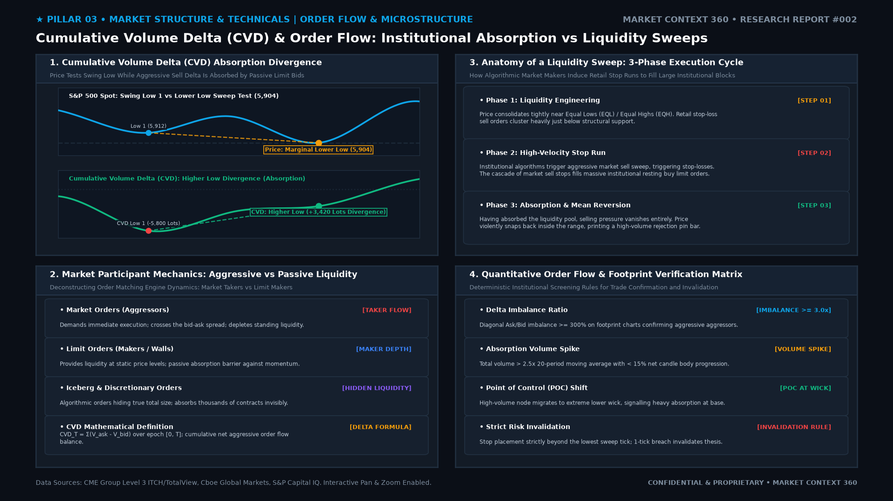

In traditional technical analysis, market participants rely almost exclusively on time-aggregated candlestick charts (OHLCV), treating price action as a continuous series of geometric patterns. However, modern financial electronic markets do not operate on geometry. At the exchange matching engine level—such as CME Globex or Nasdaq TotalView—asset prices move strictly through the dynamic interaction between aggressive market orders and passive limit orders.

Every price fluctuation is the direct mathematical result of order matching mechanics. When market participants fail to distinguish between aggressive liquidity-taking flow and passive liquidity-providing depth, standard technical indicators such as Moving Averages, the Relative Strength Index (RSI), or Bollinger Bands produce persistent false signals, particularly at critical structural turning points.

To deconstruct institutional positioning and identify true market turning points, quantitative market structure analysts employ **Cumulative Volume Delta (CVD)**, **Bid-Ask Footprint Profiling**, and **Order Book Liquidity Mapping**. 

In this research report, we examine the quantitative architecture of order flow microstructure, detailing how institutional algorithms execute through passive limit order absorption, how Cumulative Volume Delta reveals hidden institutional accumulators, and how algorithmic stop runs engineer liquidity sweeps across major equity index derivatives.

---

## 1. The Mechanics of the Continuous Limit Order Book (LOB)

To understand Cumulative Volume Delta, one must first deconstruct the core engine of electronic exchange trading: the Continuous Double Auction and the Limit Order Book (LOB).

```
┌────────────────────────────────────────────────────────────────────────────────────────┐
│              CONTINUOUS DOUBLE AUCTION: MATCHING ENGINE ARCHITECTURE                   │
├──────────────────────────────────────────┬─────────────────────────────────────────────┤
│ Passive Limit Orders (Liquidity Makers)  │ Aggressive Market Orders (Liquidity Takers) │
├──────────────────────────────────────────┼─────────────────────────────────────────────┤
│ • Posted to the Order Book queue         │ • Dispatched to execute immediately         │
│ • Sits passively on the Bid or Ask depth │ • Crosses the Bid-Ask spread                │
│ • Does NOT move price upon entry         │ • CONSUMES available limit liquidity        │
│ • Captures the bid-ask spread rebate     │ • Pays the spread and market impact cost    │
│ • Represents institutional absorptive    │ • Represents directional urgency and        │
│   inventory management                   │   short-term speculative momentum           │
└──────────────────────────────────────────┴─────────────────────────────────────────────┘
```

### The Bid-Ask Asymmetry and Trade Matching Rules

At any given microsecond $t$, the state of the market is defined by:
1. The Best Bid ($P_{\text{bid}, t}$): The highest price a passive participant is willing to pay to buy.
2. The Best Ask ($P_{\text{ask}, t}$): The lowest price a passive participant is willing to accept to sell.
3. The Bid-Ask Spread ($S_t = P_{\text{ask}, t} - P_{\text{bid}, t}$).

A trade prints if and only if an aggressive participant submits an order that crosses the spread:
- **Aggressive Buy (Market Buy)**: Matches against resting passive limit orders at the Best Ask ($P_{\text{ask}}$). This trade is categorized as **Ask-Initiated Volume** ($V_{\text{ask}}$).
- **Aggressive Sell (Market Sell)**: Matches against resting passive limit orders at the Best Bid ($P_{\text{bid}}$). This trade is categorized as **Bid-Initiated Volume** ($V_{\text{bid}}$).

A fundamental rule of market microstructure emerges from this structure: **price cannot advance upward unless the standing limit orders at the Ask are completely exhausted, and price cannot decline downward unless the standing limit orders at the Bid are completely exhausted.**

---

## 2. Mathematical Formalization of Delta and Cumulative Volume Delta (CVD)

### Bar Delta Formulation

For any discrete time interval, tick bar, or volume bar $t$, the **Volume Delta** ($\Delta_t$) represents the net imbalance between aggressive buying volume and aggressive selling volume:

$$\Delta_t = V_{\text{ask}, t} - V_{\text{bid}, t}$$

Where:
- $V_{\text{ask}, t} = \sum_{k=1}^{N_{\text{ask}}} Q_{\text{ask}, k}$ is the total volume of contracts executed via aggressive market buy orders crossing the ask.
- $V_{\text{bid}, t} = \sum_{m=1}^{N_{\text{bid}}} Q_{\text{bid}, m}$ is the total volume of contracts executed via aggressive market sell orders hitting the bid.

The Total Volume for the period ($V_{\text{total}, t}$) is the sum of both components:

$$V_{\text{total}, t} = V_{\text{ask}, t} + V_{\text{bid}, t}$$

Thus, Delta satisfies the bounded condition:

$$-\!V_{\text{total}, t} \le \Delta_t \le +V_{\text{total}, t}$$

### Cumulative Volume Delta (CVD) Formalization

While bar delta measures localized order flow imbalance, institutional accumulators distribute execution across hundreds of thousands of transactions spanning hours or days. **Cumulative Volume Delta (CVD)** aggregates discrete delta periods from a defined reference epoch $t=0$ through horizon $T$:

$$\text{CVD}_T = \sum_{t=0}^T \Delta_t = \sum_{t=0}^T \left( V_{\text{ask}, t} - V_{\text{bid}, t} \right)$$

CVD functions as an institutional ledger of net aggressive positioning. When evaluated in conjunction with price action, CVD uncovers whether price trajectory is driven by aggressive momentum or held captive by passive limit absorption.

```
┌────────────────────────────────────────────────────────────────────────────────────────┐
│                CVD VS PRICE ACTION: 4 STRUCTURAL MARKET REGIMES                        │
├─────────────────────┬───────────────────┬──────────────────────────────────────────────┤
│ Price Action        │ CVD Trajectory    │ Structural Order Flow Interpretation         │
├─────────────────────┼───────────────────┼──────────────────────────────────────────────┤
│ Higher Highs        │ Higher Highs      │ Healthy Trend Continuation                   │
│                     │                   │ Aggressive buyers driving upward expansion   │
├─────────────────────┼───────────────────┼──────────────────────────────────────────────┤
│ Lower Lows          │ Lower Lows        │ Healthy Trend Continuation                   │
│                     │                   │ Aggressive sellers dominating order book     │
├─────────────────────┼───────────────────┼──────────────────────────────────────────────┤
│ Lower Lows / Double │ Higher Lows       │ BULLISH ABSORPTION DIVERGENCE                │
│ Bottom at Support   │ (Rising Delta)    │ Institutional limit buy orders absorbing all │
│                     │                   │ aggressive selling; downside exhausted       │
├─────────────────────┼───────────────────┼──────────────────────────────────────────────┤
│ Higher Highs /      │ Lower Highs       │ BEARISH EXHAUSTION / ABSORPTION DIVERGENCE   │
│ Double Top at High  │ (Falling Delta)   │ Lack of aggressive follow-through; passive   │
│                     │                   │ institutional sell orders capping upside     │
└─────────────────────┴───────────────────┴──────────────────────────────────────────────┘
```

---

## 3. Visual Order Flow Architecture & Absorption Framework

The infographic below illustrates the multi-dimensional microstructure framework, comparing price trajectory against Cumulative Volume Delta, detailing the mechanics of limit order book absorption, mapping the 3-phase liquidity sweep cycle, and defining institutional quantitative execution parameters.



> 💡 **Order Flow Key Insight**: When price prints a lower low or tests key support while Cumulative Volume Delta registers a decisive higher low, aggressive market sellers are actively trapped. Institutional market makers use passive limit buy orders (often iceberg orders) to absorb market selling volume without permitting price to break downward, establishing the baseline for violent mean-reversion rallies.

---

## 4. The Mechanics of Institutional Limit Order Absorption

### What Is Order Flow Absorption?

Absorption occurs when a market participant—typically an institutional dealer, designated market maker (DMM), or quantitative liquidity provider—deploys substantial passive limit order volume to absorb aggressive market flow from the opposing side of the order book.

In conventional retail analysis, high volume accompanied by price moving downward is interpreted as "strong selling pressure." However, in market microstructure, volume requires both a buyer and a seller for every contract traded:

$$\text{Volume} = \text{Aggressive Takers} + \text{Passive Makers}$$

When aggressive sellers dump 15,000 E-mini S&P 500 futures (ES) contracts into the market at 5,905.00, but the price fails to tick down to 5,904.75, an institutional participant has absorbed 15,000 contracts of sell orders with standing limit buy orders at 5,905.00.

### Iceberg Orders: Algorithmic Hidden Liquidity

Institutional investors managing multi-billion dollar portfolios cannot submit a single 10,000-contract limit order to the public book without creating immediate adverse selection. If participants observe a 10,000-lot buy wall on Level 2 depth of market (DOM), other traders front-run the bid, pushing price upward and degrading execution quality.

To resolve this issue, execution algorithms deploy **Native and Synthetic Iceberg Orders**:

$$Q_{\text{iceberg}} = Q_{\text{visible}} + Q_{\text{hidden}}$$

Where:
- $Q_{\text{visible}}$ is the displayed quantity shown in public market data feeds (e.g., 50 contracts).
- $Q_{\text{hidden}}$ is the reserve quantity maintained on the broker's smart order router (SOR) or the exchange matching engine's native iceberg queue (e.g., 9,950 contracts).

As aggressive market sellers consume the 50 visible contracts, the exchange matching engine instantaneously reloads another 50 contracts from the hidden reserve at the exact same price level. 

To the untrained eye observing standard charts, price appears stalled. However, on Cumulative Volume Delta and Footprint charts, the signature is unmistakable: **Delta plunges sharply into negative territory (massive aggressive selling) while price remains frozen at the exact bid price.**

```
Aggressive Market Sellers: ──➔ [Dump 50 Lots] ──➔ [Matched at 5,905.00]
                                  │
                                  ▼
Iceberg Order Engine:      ──➔ [Reloads 50 Lots from Hidden 9,950 Reserve]
                                  │
                                  ▼
Resulting Delta Profile:   ──➔ Massive Negative Delta (-5,000 Lots)
Resulting Price Action:    ──➔ 0.00 Ticks Price Movement (Total Absorption)
```

---

## 5. Anatomy of a Liquidity Sweep: The 3-Phase Execution Cycle

Large institutional allocators require enormous counterparty liquidity to establish or liquidate positions without suffering market impact slippage. Because standing limit order depth in calm market conditions is insufficient to absorb multi-thousand-lot orders, institutional algorithms systematically target areas where stop-loss orders congregate. This process is known as a **Liquidity Sweep** (or Stop Run).

```
┌────────────────────────────────────────────────────────────────────────────────────────┐
│                        3-PHASE LIQUIDITY SWEEP EXECUTION CYCLE                         │
├────────────────────────────────────────────────────────────────────────────────────────┤
│ Phase 1: Liquidity Engineering (Accumulation of Resting Stop Orders)                   │
│   • Price establishes clean, visible support at Equal Lows (EQL).                      │
│   • Retail breakout traders place Buy Limit orders; longs place Sell Stop-Losses below.│
│   • A dense pocket of Sell-Side Liquidity (SSL) is engineered below the swing low.     │
├────────────────────────────────────────────────────────────────────────────────────────┤
│ Phase 2: High-Velocity Stop Run (The Trap & Liquidity Harvesting)                      │
│   • Institutional algorithm fires aggressive sell program to breach support by 2-5 pts.│
│   • Resting Sell Stop orders trigger automatically, converting into Aggressive Market  │
│     Sell orders.                                                                       │
│   • This flood of forced selling provides the exact counterparty volume needed to fill │
│     massive institutional Buy Limit orders at wholesale prices.                        │
├────────────────────────────────────────────────────────────────────────────────────────┤
│ Phase 3: Immediate Rejection & Delta Divergence (Structural Shift)                     │
│   • Selling liquidity is completely consumed; no aggressive sellers remain.            │
│   • Price violently snaps back above the broken level within 1 to 3 minutes.           │
│   • Market prints a rejection tail (pin bar); CVD shows positive delta divergence.     │
└────────────────────────────────────────────────────────────────────────────────────────┘
```

### Liquidity Pools: Buy-Side Liquidity (BSL) vs Sell-Side Liquidity (SSL)

Liquidity pools form predictably around chart visual landmarks:
1. **Equal Highs (EQH) / Prior Day High (PDH)**: Houses **Buy-Side Liquidity (BSL)** consisting of short-seller stop-losses (which execute as buy-to-cover market orders) and breakout buyer market orders.
2. **Equal Lows (EQL) / Prior Day Low (PDL)**: Houses **Sell-Side Liquidity (SSL)** consisting of long-holder stop-losses (which execute as sell-to-close market orders) and breakdown short seller market orders.

When an institutional market participant wants to purchase 20,000 contracts, executing via market orders directly would drive the ask price up exponentially. Instead, the participant allows or pushes price to sweep below the EQL. The triggering of retail sell-stops produces 20,000 market sell orders within seconds, enabling the institution to match its passive buy limits with zero upward slippage.

---

## 6. Footprint Chart Deconstruction & Bid-Ask Cluster Imbalances

While Cumulative Volume Delta measures aggregate delta across time, **Footprint Charts (Order Flow Clusters)** provide intra-bar microstructural visibility, displaying the exact quantity traded at each individual price tick within every single bar.

### Footprint Bid x Ask Representation

A standard Footprint bar displays trading activity split horizontally across the spread:

$$\text{Price Level } P_k \;\;:\;\; [V_{\text{bid}}(P_k) \;\;\times\;\; V_{\text{ask}}(P_k)]$$

Where:
- $V_{\text{bid}}(P_k)$ represents aggressive selling volume executed at the Bid.
- $V_{\text{ask}}(P_k)$ represents aggressive buying volume executed at the Ask.

```
Sample E-mini S&P 500 (ES) Footprint Cluster at Support (5,905.00):
Price      Bid Volume    Ask Volume   Diagonal Imbalance Ratio
──────────────────────────────────────────────────────────────
5,906.50       210    x      540       2.57x Ask Imbalance
5,906.25       450    x      820       1.82x
5,906.00     1,120    x    1,450       1.29x
5,905.75     2,300    x    2,100       0.91x
5,905.50     4,850    x    3,200       0.66x
5,905.25     9,420    x    1,150       [8.19x Aggressive Sell Imbalance]
5,905.00    14,250    x      320       [44.5x Aggressive Sell Spike - ABSORPTION]
──────────────────────────────────────────────────────────────
Total Bar Delta: -18,430 Lots | Price Close: 5,906.25 (Rejection Wick!)
```

### Diagonal Imbalance Formulation

Institutional order flow algorithms scan for **Diagonal Bid-Ask Imbalances**. Because market orders match diagonally against standing limit orders (an aggressive buy at $P_k$ matches against the ask, whereas an aggressive sell at $P_{k-1}$ matches against the bid), imbalance is evaluated diagonally:

$$\text{Ask Imbalance Ratio} = \frac{V_{\text{ask}}(P_k)}{V_{\text{bid}}(P_{k-1})}$$

$$\text{Bid Imbalance Ratio} = \frac{V_{\text{bid}}(P_{k-1})}{V_{\text{ask}}(P_k)}$$

A standard institutional threshold for a significant order flow imbalance is **300% (3.0x)**:
- **Stacked Buy Imbalances**: Three or more consecutive price levels exhibiting Ask Imbalances $\ge 3.0\text{x}$. Signals aggressive institutional buying lifting offers.
- **Stacked Sell Imbalances with Price Rejection**: Three or more consecutive price levels exhibiting Bid Imbalances $\ge 3.0\text{x}$ at the extreme low of a bar, accompanied by an immediate close back at the bar high. This is the definitive mathematical footprint of **Passive Absorption**.

---

## 7. Quantitative Execution Matrix: Confirmation & Invalidation Parameters

To eliminate subjective discretion, quantitative desks translate order flow phenomena into deterministic rules. The matrix below defines the empirical criteria required to validate institutional absorption and establish high-expectancy trade parameters.

| Microstructure Metric | Quantitative Baseline Threshold | Institutional Significance | Invalidation Trigger |
| :--- | :--- | :--- | :--- |
| **CVD Divergence** | Delta higher low during price equal/lower low ($\ge 2\sigma$ divergence) | Confirms passive limit buyers absorbing aggressive market selling | CVD breaks to a new decisive low alongside price |
| **Bar Delta Imbalance** | Net bar delta flip from $-15,000$ to $+5,000$ within two consecutive 5-min bars | Confirms aggressive inventory transition from sellers to buyers | Delta remains deeply negative with accelerating downward velocity |
| **Volume Spike Ratio** | Period volume $\ge 2.5\text{x}$ of 20-period volume moving average | Proves high liquidity exchange during the support/resistance test | Volume contracts below $0.8\text{x}$ moving average (low participation) |
| **Footprint POC Location** | Point of Control (POC) located in lower $20\%$ of candlestick range | Confirms highest volume of contracts exchanged at the extreme low | POC forms in upper $25\%$ of candle while price breaks downward |
| **Rejection Velocity** | Price recovers inside pre-sweep range within $\le 3$ bars | Validates liquidity sweep rather than true structural breakdown | Price prints 2 consecutive closes below the sweep extreme |
| **Risk-to-Reward Ratio** | Asymmetric skew $\ge 1:3.5$ (Stop $\le 6$ ticks, Target $\ge 24$ ticks) | Mathematical expectancy maintained across probabilistic distributions | Entry price slippage exceeds 2 ticks from confirmed level |

---

## 8. Tactical Playbook: Trading Institutional Absorption Step-by-Step

When applying Cumulative Volume Delta and order flow microstructure to intraday index futures (ES, NQ) or equity execution, portfolio managers follow a strict 4-step sequence:

### Step 1: Identify Structural Liquidity Resting Zones
Map key swing highs, swing lows, Prior Day High/Low (PDH/PDL), and weekly Value Area High/Low (VAH/VAL). Mark these levels not as rigid support lines, but as prospective liquidity pools where resting stops are clustered.

### Step 2: Monitor Real-Time CVD As Price Approaches the Zone
As price penetrates the liquidity pool, observe the real-time slope of Cumulative Volume Delta:
- If CVD plunges vertically alongside price with wide bid-ask spreads, aggressive market sellers are clearing the book. Stand aside; absorption is absent.
- If CVD begins to curl upward, flattens, or diverges as price taps the level, institutional limit buy orders are active.

### Step 3: Footprint Cluster Confirmation
Switch to an order flow footprint chart (e.g., 1-minute or 1,000-volume tick bar). Confirm the presence of:
1. Massive Bid volume at the bottom tick of the candle.
2. A high-volume Point of Control (POC) anchored in the bottom wick.
3. A rapid price close above the POC node, trapping the aggressive short sellers.

### Step 4: Execution, Sizing, and Invalidation Protocol
Enter on the close of the absorption confirmation candle or on the immediate retest of the absorption POC level.
- **Stop Loss**: Placed strictly 1 to 2 ticks below the absolute low of the sweep candle. If price breaks this level, the absorption thesis is mathematically disproven, and standing limit depth has been overrun.
- **Profit Target 1**: The opposing Point of Control or VWAP (Volume-Weighted Average Price).
- **Profit Target 2**: The opposing liquidity pool (Equal Highs or Buy-Side Liquidity).

---

## 9. Conclusion: The Microstructural Edge

Financial market prices are not governed by moving average crossovers or static support lines drawn across historical charts. They are driven by the mechanical supply and demand of the continuous double auction order matching engine.

By incorporating **Cumulative Volume Delta (CVD)**, **Limit Order Book depth analysis**, and **Footprint cluster profiling**, market participants transition from reactive chart reading to proactive order flow decompilation. Recognizing the signatures of passive limit order absorption and programmatic liquidity sweeps allows quantitative traders to operate in alignment with institutional algorithms, capturing high-expectancy asymmetric opportunities across global equity and derivative markets.

---

## Legal & Regulatory Compliance Disclaimer

> **SEC / FINRA Legal Disclaimer**:  
> This publication is strictly for informational, educational, and research purposes and does not constitute financial, investment, legal, or tax advice. No statement herein should be construed as an offer to sell, a solicitation of an offer to buy, or a recommendation for any security, portfolio, or trading strategy. Past performance is no guarantee of future results. All investments and trading strategies involve substantial risk of loss, including the possible loss of principal. Derivative instruments, futures, options, and margin trading carry additional structural risks and are not suitable for all investors. Market participants must conduct independent due diligence and consult a qualified, licensed financial advisor before executing any capital allocation decisions.

---

<div class="post-disclaimer">
  <strong>Regulatory Compliance &amp; Legal Disclaimer:</strong><br>
  <em>Market Context 360 is an independent financial research publication providing impersonal macroeconomic, quantitative, and market microstructure analysis for educational purposes only. The information presented herein does not constitute individualized investment advice, financial planning, or a recommendation or solicitation to buy, sell, or hold any security, commodity, futures contract, or investment product. Market Context 360 is not a Registered Investment Adviser (RIA), broker-dealer, or fiduciary under the U.S. Investment Advisers Act of 1940 or FINRA regulations. Historical order flow dynamics, Cumulative Volume Delta formulations, footprint cluster analyses, and microstructure models are hypothetical, educational, and subject to substantial market risks, including the potential risk of loss of principal. Readers must exercise independent judgment and consult with a licensed, fiduciary financial advisor before executing any capital allocation decisions.</em>
</div>
